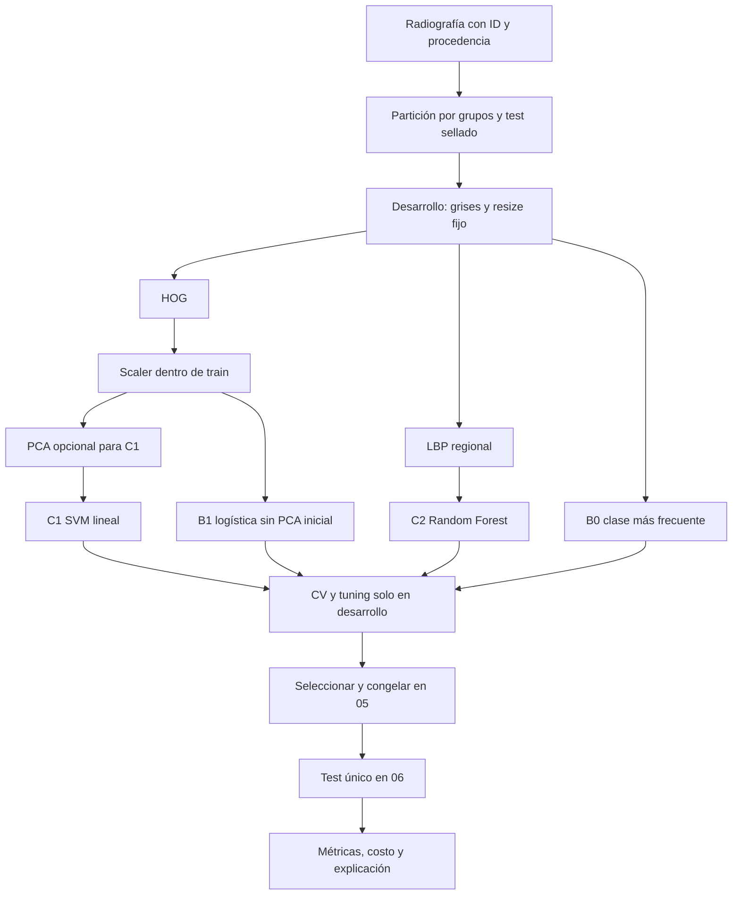

# Comparativa entre el TFC original y nuestra propuesta

**Integrantes:** Juan Quirós y Andruszyszyn. **Fecha:** 09/10/2026. **Estado:** documento de planificación y estudio; nuestra alternativa **todavía no fue implementada**. No se descargó el dataset, no se entrenaron candidatos y no hay métricas propias.

**Convención:** [A] significa evidencia reportada por el TFC, [B] requisito de la consigna, [C] diseño o análisis propio y [D] hipótesis pendiente de experimentación. Una cifra del TFC no implica que hayamos reproducido su ejecución. Sus páginas y discrepancias se registran en [Fuentes y trazabilidad](FUENTES_Y_TRAZABILIDAD.md).

Este documento acompaña al [Roadmap](ROADMAP_TFI.md), al [material de estudio](TEORIA_Y_STACK.md) y a los [planes de ejecución](ejecucion/README.md). Si cambian etiquetas, arquitectura, candidatos o evaluación en el roadmap, actualizar también esta comparativa y los sprints afectados.

# 1. Introducción

Comparar permite entender qué aporta una alternativa y qué evidencia necesitaríamos para sostenerlo. La consigna no pide reemplazar una biblioteca por otra: exige otra solución fundamentada y seleccionada mediante experimentos [B, TFI §5.2]. Por eso separaremos tres preguntas: cómo representa cada enfoque la imagen, cómo aprende la clasificación y cómo se evalúa su resultado.

El TFC de Vega Lencina y Armoa, dirigido por Karina Eckert en 2023, ya tiene una CNN y resultados publicados [A]. Nosotros tenemos un diseño clásico y un protocolo por ejecutar [C]. Una comparación honesta puede identificar ventajas potenciales y límites actuales sin declarar que la alternativa será mejor.

# 2. Problema común

Ambos trabajos se sitúan en clasificación de radiografías de tórax relacionadas con COVID-19. La entrada es una imagen y la salida una categoría binaria. El problema original nació en contexto de pandemia como apoyo al reconocimiento de signos radiográficos [A, pp. 6–7]. Nuestro propósito es académico: analizar una solución y evaluar otra [C].

La equivalencia de etiquetas necesita precisión. D4 del TFC enfrenta imágenes etiquetadas **COVID con imágenes normales**. Su clase NO COVID no cubre todas las enfermedades no COVID. Mantendremos inicialmente esa definición para una comparación posible; no afirmaremos diagnóstico diferencial ni capacidad frente a cualquier radiografía negativa.

También distinguimos etiqueta de infección y signo visible. Una imagen etiquetada COVID puede no exhibir signos característicos, y una alteración radiográfica no identifica por sí sola una causa. El sistema es un prototipo académico y **no reemplaza diagnóstico médico, evaluación clínica, pruebas diagnósticas oficiales ni criterio profesional**.

# 3. Solución del TFC original [A]

Su recorrido resumido es **radiografía → CNN → COVID / NO COVID**. Dentro de la CNN hay una etapa que aprende representaciones y otra que combina esas representaciones para clasificar.

**Datos:** COVID-19 Radiography Database, PNG 299×299. El conjunto de referencia contiene 3615 COVID, 10192 normales, 6012 opacidad pulmonar y 1345 neumonía viral (p. 33). Los autores construyeron cuatro configuraciones: D1 incluye las tres patologías como positivas; D2 elimina opacidad; D3 conserva solo COVID frente a normales; D4 depura manualmente D3 y conserva 2462 imágenes de cada clase (pp. 34–36). La limpieza de D4 retiró imágenes consideradas defectuosas sin acompañamiento profesional disponible. No conocemos sus IDs exactos a partir del PDF.

**Preparación:** train/validation/test declarados 80/10/10; grises y `/255` en entrenamiento/validación; aumento solo de train mediante inclinación, zoom y volteo horizontal. Las tablas de partición contienen discrepancias señaladas en el roadmap. El código de test publicado no aplica el reescalado: es una inconsistencia verificable de anexos, cuyo efecto experimental no podemos cuantificar sin reproducir la versión ejecutada.

**CNN:** entrada 299×299×1; convolución de 32 filtros 3×3, pooling 2×2; convolución de 64 filtros 2×2, pooling 2×2; tercera convolución de 64 filtros 2×2; Flatten; Dense de 64 neuronas; Dropout 0,5; Dense de dos salidas con Softmax. Las convoluciones y la Dense intermedia utilizan ReLU. Los anexos I–II confirman **dos pooling**, pese a posibles ambigüedades de la prosa (pp. 68–72).

Las convoluciones aprenden filtros locales; pooling reduce resolución; Flatten convierte mapas en 350464 valores; Dense combina esos valores; Dropout regulariza durante train y Softmax transforma puntuaciones en dos valores que suman uno. No son porcentajes certificados de acierto para un paciente. El total es **22454914 parámetros**, casi todos concentrados en Dense.

**Entrenamiento:** Adam, learning rate 0,0005, pérdida categorical crossentropy, batch 32 y 20 épocas. Python, TensorFlow/Keras, NumPy, Matplotlib, scikit-learn, Anaconda y mlxtend forman parte del stack documentado. Notebook con i7-7700HQ, 16 GB RAM y SSD; no se identifica GPU utilizada (pp. 36–41 y anexos).

**Evaluación:** tres entrenamientos por dataset, doce pruebas, métricas por clase en test y curvas train/validation. Mejor test publicado: **D4, prueba 10, accuracy 79,47 %**. Se consultó a un médico sobre 52 radiografías del test, con 37 coincidencias, 12 discrepancias y 3 indefinidas: acuerdo de 37/49 entre casos clasificables (pp. 58–59). Es una revisión limitada, no validación clínica externa.

# 4. Nuestra propuesta [C, D]

El recorrido propuesto es **radiografía → preprocesamiento → características explícitas → posible reducción → clasificador clásico → COVID / normal**. Se trata de aprendizaje supervisado: los descriptores son explícitos, pero el clasificador igualmente aprende de ejemplos etiquetados.

| Componente | Función concreta | Estado de decisión |
|---|---|---|
| Preprocesamiento | Grises, 128×128 inicial, rango/interpolación/aspecto definidos | Propuesta por costo; se fundamenta en EDA de desarrollo |
| HOG | Histogramas locales de orientación de gradientes, 8100 atributos en configuración inicial | Representación principal propuesta |
| LBP | Histogramas regionales de patrones binarios de textura, 160 atributos iniciales | Representación complementaria propuesta |
| PCA | Proyección a componentes de mayor varianza | Ablación opcional de HOG-SVM; no parte obligatoria de toda ruta |
| B0 | DummyClassifier most_frequent | Baseline mínima obligatoria |
| B1 | HOG → StandardScaler → logística L2 | Referencia lineal adicional recomendada |
| C1 | HOG → StandardScaler → SVM lineal | Candidato principal recomendado, sin elección anticipada de ganador |
| C2 | LBP → Random Forest | Segundo candidato principal |
| KNN | LBP → scaler → vecinos | Alternativa opcional de estudio, limitada por costo de inferencia |
| RBF / otras combinaciones | SVM no lineal o descriptor común para aislar factores | Extensiones acotadas si hay justificación y presupuesto |

Todavía deben validarse la señal de HOG/LBP, el uso de PCA, hiperparámetros, variabilidad, costo y facilidad real de interpretación. **No sabemos** qué modelo tendrá mejor F1 macro ni si alguno superará la CNN publicada. Comparar HOG-SVM con LBP-RF compara pipelines completos; para atribuir efecto al clasificador se necesitaría mantener descriptor constante.

# 5. Comparación conceptual

| Aspecto | TFC original [A] | Propuesta por evaluar [C, D] |
|---|---|---|
| Problema | Clasificar signos/etiquetas de COVID en radiografías en contexto pandémico | Clasificación académica de COVID frente a normales, con alcance explícito |
| Paradigma | Deep Learning mediante CNN | Feature engineering más ML clásico |
| Tipo de aprendizaje | Supervisado | Supervisado; PCA opcional es transformación no supervisada interna |
| Datos | Cuatro configuraciones de la base pública | Preferencia por criterio comparable a D4; identidad exacta pendiente |
| Entrada | Imagen 299×299×1 | Imagen preprocesada 128×128 inicialmente; clasificador recibe vector |
| Etiquetas | Cambian entre D1/D2 y D3/D4 | COVID=1, normal=0; no copiar índices originales sin mapear |
| Extracción de características | Filtros ajustados durante entrenamiento | HOG/LBP calculados con reglas explícitas por imagen |
| Representación interna | Mapas aprendidos, luego vector de 350464 | HOG 8100 o LBP 160 inicialmente; componentes si PCA resulta pertinente |
| Modelo | CNN con Dense y Softmax | B0/B1 y candidatos SVM/RF; otros opcionales |
| Entrenamiento | Ajuste conjunto de filtros y capas densas | Ajuste de scaler/PCA y clasificador en cada train; descriptores fijos |
| Hiperparámetros | Filtros, kernels, lr, batch, épocas, dropout | Descriptor, resolución, C, profundidad, hojas, PCA; seleccionados en desarrollo |
| Costo computacional | 22,45 millones de parámetros y costo elevado reconocido | Dependerá de n/d, extracción, búsqueda y modelo; no medido |
| Tiempo de entrenamiento | Texto reporta 40 minutos–6 horas según dataset | Pendiente; separar ajuste final, extracción y búsqueda total |
| Tiempo de inferencia | Descripción cualitativa en segundos, sin benchmark uniforme | Medición futura de extremo a extremo, mediana/p95 |
| Necesidad de GPU | No se documenta GPU empleada; no afirmar que fue necesaria | Diseño CPU inicial; factibilidad y RAM se verificarán |
| Interpretabilidad | No documenta atribuciones sistemáticas de decisión | Coeficientes/permutación según modelo; beneficio por demostrar |
| Reproducibilidad | Código y logs anexados; versiones/IDs/semillas incompletos | Versiones probadas, manifiestos, folds, hashes y comandos previstos |
| Complejidad | CNN de varias capas, gran Dense e imports mixtos | Pipeline explícito, menos infraestructura; varios candidatos añaden trabajo experimental |
| Métricas | Precision, recall, F1 por clase, accuracy y matrices | Las comunes más F1 macro, especificidad, ROC-AUC, AP, incertidumbre y recursos |
| Validación | 80/10/10 declarado, tres entrenamientos por dataset | 80 % desarrollo con CV agrupada/estratificada + 20 % test reservado |
| Selección | Prueba 10 elegida por mejor clasificación en test | Selección por CV congelada en 05, antes de test único en 06 |
| Tuning | No se documenta búsqueda sistemática equivalente | Grilla/búsqueda aleatoria explícita y presupuesto |
| Sensibilidad a calidad | Limitación reconocida, limpieza manual D4 | HOG/LBP también sensibles a ruido, recorte y marcas; controles de calidad |
| Validación profesional | Un profesional, 52 imágenes de test | No nueva validación médica prevista; no reclamar equivalencia clínica |
| Ventajas | Representación adaptable aprendida y evidencia publicada | Posible menor costo, representación inspeccionable y protocolo reproducible |
| Limitaciones | Comparabilidad, documentación, selección, costo y muestra profesional limitada | Pérdida de señal, sesgo por fuente, muestra limitada y falta de resultados propios |

# 6. Feature learning vs feature engineering

**Feature learning** significa aprender una representación a partir de datos y un objetivo. En la CNN original, los valores de los filtros cambian con el entrenamiento: el error de clasificación se propaga hacia las capas anteriores y modifica qué respuestas visuales favorece el sistema. Los autores eligen la arquitectura, pero no escriben a mano cada filtro para detectar un signo.

**Feature engineering** significa diseñar cómo representar la entrada. Con HOG elegimos celdas, bloques y orientaciones para resumir gradientes; con LBP elegimos vecindarios e histogramas de textura. Para una misma imagen y configuración fija obtenemos el mismo vector sin necesitar etiquetas. Después SVM, RF o logística aprenden a relacionar esos valores con la clase.

Un ejemplo: una costilla, un borde torácico y una etiqueta escrita pueden producir cambios de intensidad. HOG registra orientaciones sin saber su significado; una CNN podría aprender a amplificar o ignorar determinadas respuestas. **Ambos pueden explotar señales espurias**. Lo explícito no garantiza que el descriptor seleccione información clínicamente pertinente.

La diferencia central es dónde ponemos capacidad de adaptación: la CNN ajusta representación y decisión conjuntamente; nuestra ruta fija primero una familia de representaciones y adapta la decisión, con PCA/escalado aprendidos si corresponde. Eso puede ahorrar parámetros, pero también impedir capturar patrones que la CNN sí podría aprender [D].

# 7. Deep Learning vs ML clásico en este proyecto

No estamos comparando “todos los modelos profundos” con “todos los clásicos”. Estudiaremos esta CNN descrita en 2023 y un conjunto acotado de pipelines. Una CNN moderna diferente o transferencia de aprendizaje sería otro experimento, fuera del mínimo.

La Dense original recibe 350464 entradas y concentra más de 22 millones de parámetros. La ruta HOG-SVM lineal usa 8100 atributos inicialmente y una frontera lineal: es una razón concreta para estudiar complejidad y costo. Pero una búsqueda de muchos SVM/RF, PCA costosa o KNN con muchos ejemplos puede demandar recursos importantes. “Clásico” no significa automáticamente pequeño o rápido.

En interpretación, HOG nos permite localizar bloques y orientaciones del descriptor y un modelo lineal permite leer coeficientes. Eso puede ayudar a la defensa técnica. Sin embargo, no transforma pesos en explicación clínica; RF no se vuelve transparente por ser clásico y PCA mezcla variables. La hipótesis de mayor interpretabilidad debe discutirse con ejemplos reales y límites.

# 8. Pipeline lado a lado

## TFC original [A]

```mermaid
flowchart LR
    A[Radiografía 299 x 299] --> B[Grises y reescalado en train/validation]
    B --> C[Conv32 3x3 y ReLU]
    C --> D[MaxPooling 2x2]
    D --> E[Conv64 2x2 y ReLU]
    E --> F[MaxPooling 2x2]
    F --> G[Conv64 2x2 y ReLU]
    G --> H[Flatten 350464]
    H --> I[Dense64 ReLU]
    I --> J[Dropout 0.5 en train]
    J --> K[Dense2 Softmax]
    K --> L[COVID o NO COVID]
```

El diagrama refleja anexos I–II. **Advertencia documental concreta:** anexo IV omite reescalado de test y anexo III omite además grayscale explícito; no presentamos esos fragmentos como una ruta de inferencia verificada.

## Nuestra propuesta [C]

B0 ignora la imagen: la flecha indica participación en la misma comparación, no dependencia de sus features. PCA se estudia como ablación de C1; B1 comienza sin PCA. KNN/RBF son opcionales y no aparecen como rutas obligatorias.

# 9. Comparación metodológica

**Original [A]:** 80/10/10 declarado. Validation se usa durante las 20 épocas y test se utiliza en las doce pruebas; después se selecciona la prueba 10 por desempeño en clasificación. No se documenta un procedimiento experimental de K-fold. Las cifras de conteos no son completamente coherentes entre tablas y algunas matrices; no afirmamos una reconstrucción exacta sin manifiestos.

**Propuesta [C]:** 80 % de desarrollo y 20 % test aproximados, priorizando grupos independientes; cinco folds dentro de desarrollo. En cada fold, cuatro partes entrenan y una valida. Scaler/PCA se ajustan solo con train del fold; al concluir búsqueda, se reentrena el elegido en todo desarrollo. Esto no añade otro holdout de validación fijo. Las proporciones aproximadas por ajuste son 64 % train y 16 % validation del total.

Pretendemos introducir: grupos/pacientes y duplicados auditados, folds comunes para comparar, entorno y configuración identificados, búsqueda acotada, promedio/desvío y selección previa a test. Son **controles previstos**, no garantías ya comprobadas. Sin IDs de pacientes quedará riesgo residual; Pipeline no lo elimina.

La selección queda congelada en **05**. **06** evalúa final y comparadores en un mismo lote predefinido, guarda predicciones y no reelige al ganador. **07** explica esos errores sin volver a ajustar. El test sirve una sola vez para evaluación; recalcular una tabla desde predicciones congeladas no significa abrir un ciclo de selección nuevo.

# 10. Comparación de evaluación

| Dimensión | Evidencia disponible del TFC [A] | Evidencia futura nuestra [C] |
|---|---|---|
| Desempeño binario | Doce matrices/reportes, métricas por clase y accuracy | Matriz, accuracy, F1 macro y por clase, precision, recall, especificidad |
| Validación | Valores train/validation por entrenamiento | CV común de baseline/candidatos, media ± desvío muestral |
| Ranking | No ROC-AUC/AP reportados en tablas principales | Scores continuos, ROC-AUC y AP, prevalencia y método explícitos |
| Incertidumbre | Sin contraste inferencial de métodos reportado | Intervalos/contrastes predefinidos si se cumplen supuestos |
| Tiempo | Rango narrativo 40 minutos–6 horas; logs por época | Extracción, búsqueda, fit final e inferencia completa medidos |
| Recursos | Hardware y parámetros de CNN documentados | RAM pico, hilos, hardware, tamaño de artefacto y dimensiones |
| Explicaciones | Revisión profesional de fallos | Coeficientes/permutación según modelo y análisis descriptivo |

Todos nuestros valores están **pendientes**. No llenar tablas con ceros para simular ausencia de error o costo. No comparar AUC propia con accuracy del TFC: describen propiedades distintas.

Para McNemar necesitamos dos predicciones sobre cada misma unidad independiente y etiquetas comunes; 79,47 % no aporta esos pares. Wilcoxon sobre cinco folds solapados tampoco justifica independencia. Si no hay datos equivalentes, la comparación con CNN será descriptiva y la estadística se limitará a comparadores propios válidos bajo el protocolo.

# 11. Resultado de referencia

**Benchmark histórico, no objetivo obligatorio:** D4, prueba 10, tabla 13 y figura 38 p. 53; resumen tabla 17 p. 57.

| Métrica | COVID | NO COVID / normal |
|---|---:|---:|
| Precision | 0,7912 | 0,7984 |
| Recall | 0,8008 | 0,7886 |
| F1 | 0,7960 | 0,7935 |
| Accuracy global | **0,7947 = 79,47 %** | Misma métrica global |

La matriz tiene VP197, FN49, FP52 y VN194, N=492. La especificidad es 194/(194+52)≈0,7886. Son datos originales y una interpretación aritmética de su matriz. El accuracy de validation de ese entrenamiento fue 0,8208; no mezclarlo con test.

Hay variación entre entrenamientos D4: pruebas 11 y 12 obtuvieron 67,07 % y 66,06 % de accuracy test. Mostrar solo el máximo ocultaría esa variabilidad. El TFC atribuye mejora a depuración, pero el diseño no separa causalmente limpieza, cambios de población/split y azar.

Condiciones de referencia: etiquetas comparables, población/calidad/versión trazables, test independiente y costo medido con igual alcance. Sin ellas, superar numéricamente 79,47 % no demuestra superioridad del método. Si falta D4 exacto, informar comparación contextual y gestionar autorización de dataset equivalente cuando corresponda.

# 12. Qué significa “mejor”

Una solución podría ser interesante con una accuracy algo menor si ofrece un compromiso útil y medido de sensibilidad, especificidad, costo, latencia, tamaño y reproducibilidad. También podría ser inaceptable perder sensibilidad para ahorrar poco tiempo. No fijaremos retrospectivamente qué dimensión importa para favorecer el resultado obtenido.

En este proyecto la selección propuesta usa F1 macro medio de CV y una regla operativa de desempate previa. La evaluación final presentará todas las métricas relevantes. El éxito académico no exige ganar un ranking: exige justificar decisiones, medir correctamente y explicar condiciones en que cada enfoque resulta adecuado.

“Más simple” puede significar menos dependencias o una cadena más fácil de inspeccionar, pero no necesariamente menos líneas ni mayor exactitud. “Más interpretable” significa poder explicar componentes y evidencia de decisión, no diagnosticar una radiografía. “Menor costo” requiere medir también extracción y búsqueda, no solo llamar `predict` al clasificador.

# 13. Fortalezas y debilidades

## TFC original

| Fortalezas documentadas | Debilidades o límites, con grado de certeza |
|---|---|
| Problema y objetivos explícitos, marco CRISP-ML(Q) | Prototipo con alcance contextual; no producción validada |
| CNN coherente con entrada visual | Alto costo y problemas de portabilidad reconocidos por autores |
| Código, arquitectura y logs anexados | Faltan versiones/manifiestos/semillas para réplica exacta |
| Doce pruebas con métricas por clase | No CV experimental ni inferencia estadística documentadas |
| Revisión de datos y consulta profesional | Limpieza manual sin experto en D4; posible sesgo de selección |
| Mejor prueba cerca de 80 % en clases de D4 | Máximo seleccionado usando test; estimación final condicionada por selección |
| Análisis de errores con profesional | Un lector, 52 imágenes del mismo test, tres abstenciones |
| Evidencia que permite auditoría | Inconsistencias de escala y conteos; efecto sobre ejecución real no demostrado |

## Nuestra propuesta

| Fortalezas potenciales [D] / decisiones [C] | Riesgos potenciales [D] |
|---|---|
| Representación explícita y modelos CPU | HOG/LBP podrían perder señal necesaria |
| Modelo lineal con pesos inspeccionables | Interpretar bins no equivale a explicación clínica |
| Baseline y candidatos predefinidos | Muchas alternativas pueden sobreajustar desarrollo |
| Pipeline y ajuste dentro de folds | Pacientes/duplicados no conocidos pueden persistir |
| Manifiestos, hashes y versiones previstos | Metadatos o licencia podrían impedir réplica exacta |
| Costos medidos de extremo a extremo | Tuning/PCA/RF/KNN pueden ser más costosos de lo supuesto |
| Test único con selección previa | Test interno no prueba generalización a otra institución |
| Ética y límites explícitos | Lectores podrían interpretar “COVID” como diagnóstico si no comunicamos alcance |

Las fortalezas previstas deben comprobarse. Haber escrito un protocolo no demuestra que la implementación ya lo cumpla.

# 14. Qué estamos conservando del TFC

Conservamos el dominio de radiografías de tórax, la tarea supervisada binaria bajo el criterio de D4 y métricas comunes que permitan diálogo con la evidencia original. Preferimos una población comparable de la misma base si puede recuperarse de forma trazable. Mantenemos la importancia de calidad de imágenes, análisis de errores y las fases de entendimiento/preparación/modelado/evaluación de CRISP-ML(Q).

No conservamos automáticamente una partición cuyos IDs desconocemos ni convertimos todas las decisiones históricas en requisitos. “Mismo dataset” puede significar misma base, mismo subconjunto o mismas imágenes de test: hay que decir cuál se alcanzó.

# 15. Qué estamos cambiando

La representación pasa de filtros aprendidos por backpropagation a HOG/LBP explícitos; el clasificador pasa de capas densas integradas a SVM/RF y referencias. La selección pasa de destacar una prueba por test a comparar en CV y congelar antes de evaluación final.

También proponemos separar auditoría estructural y EDA de desarrollo, incorporar agrupación por paciente/duplicados, centralizar preprocesamiento, usar tuning explícito, versionar configuraciones y estudiar interpretabilidad según la representación. Ninguna mejora de protocolo permite afirmar de antemano mejora de desempeño.

El tamaño inicial de entrada cambia de 299×299 a 128×128 por hipótesis de costo; ello debe constar como diferencia de pipeline y puede afectar comparabilidad. Si se cambia más adelante, debe decidirse en desarrollo y actualizar todas las fuentes operativas.

# 16. Por qué la propuesta es realmente alternativa

No es la misma CNN con menos épocas. Cambia la familia de hipótesis: una CNN ajusta filtros y representación jerárquica junto con la decisión; HOG/LBP fijan reglas de representación y un algoritmo clásico aprende la separación sobre esos vectores. Una frontera de margen o un bosque de reglas se entrena con mecanismos y costos diferentes a la red original.

Ambos siguen siendo Machine Learning y usan datos etiquetados. Compartir el problema no obliga a compartir arquitectura. La diferencia técnica justifica el estudio; la comparación experimental determinará qué se gana, qué se pierde y bajo qué restricciones.

# 17. Preguntas posibles de defensa

| # | Pregunta | Respuesta corta orientativa |
|---:|---|---|
| 1 | ¿Por qué no replicaron simplemente la CNN? | La consigna exige alternativa; la evidencia original se analiza y la réplica exacta no está garantizada por falta de IDs/versiones. |
| 2 | ¿Qué diferencia existe entre CNN y SVM? | CNN aprende representación espacial y decisión; SVM recibe vectores y aprende una frontera de margen. |
| 3 | ¿Qué aprende automáticamente la CNN? | Pesos de filtros y capas densas a partir de pérdida y gradientes. |
| 4 | ¿Qué hace HOG que antes hacía la CNN? | Proporciona una representación visual, pero mediante gradientes/histogramas fijados, no filtros aprendidos. |
| 5 | ¿La comparación es justa? | Solo al nivel de equivalencia demostrado; cifras históricas con otros splits no son comparación controlada. |
| 6 | ¿Por qué usar la misma base de datos? | Reduce diferencias de dominio, aunque no garantiza mismo subconjunto, grupos o test. |
| 7 | ¿Menor accuracy implica necesariamente peor solución? | No por sí sola; debemos considerar sensibilidad, especificidad y costos sin redefinir criterios después. |
| 8 | ¿Por qué podría ser más interpretable la alternativa? | Descriptores explícitos y coeficientes pueden inspeccionarse; sigue pendiente comprobar utilidad de explicaciones. |
| 9 | ¿Qué costo tenía el TFC? | 22,45 millones de parámetros; texto reporta 40 minutos a 6 horas de entrenamiento según dataset. |
| 10 | ¿Cuál fue el mejor resultado original? | D4 prueba 10: accuracy test 79,47 %, precision COVID 79,12 %, recall 80,08 %, F1 79,60 %. |
| 11 | ¿Por qué no comparar con 90,34 %? | Es validation de prueba 9; su test fue 47,65 %. |
| 12 | ¿Qué significa NO COVID en D4? | Pulmones normales, no toda enfermedad distinta de COVID. |
| 13 | ¿La depuración causó la mejora? | Es explicación de autores, pero el diseño no aísla su efecto de otros cambios y azar. |
| 14 | ¿Cuántos pooling hay realmente? | Dos según código y resumen de anexos I–II. |
| 15 | ¿HOG necesita etiquetas? | Para calcular un vector fijo no; seleccionar su configuración requiere validación en desarrollo. |
| 16 | ¿PCA es indispensable? | No; se compara como ablación y puede empeorar discriminación o costo. |
| 17 | ¿Por qué SVM y RF? | Contrastan una frontera de margen sobre bordes y un ensemble no lineal sobre textura; la selección no está hecha. |
| 18 | ¿Por qué incluir una baseline trivial? | Establece referencia mínima y ayuda a detectar métricas engañosas. |
| 19 | ¿KNN está comprometido como candidato principal? | No, es opcional; C1 SVM y C2 RF cumplen el núcleo comparativo. |
| 20 | ¿Necesitamos GPU? | El diseño propuesto apunta a CPU; el TFC no identifica GPU usada, así que no atribuimos ese requisito al original. |
| 21 | ¿Qué mejora pretende CV? | Describir variabilidad y seleccionar en desarrollo con folds comunes, sin usar test. |
| 22 | ¿Podemos aplicar McNemar entre nuestras cifras y el PDF? | No con cifras agregadas; se necesitan predicciones pareadas independientes sobre el mismo test. |
| 23 | ¿Qué cambia si faltan IDs de D4? | Se informa comparación contextual y se justifica/autorizan datos equivalentes si corresponde. |
| 24 | ¿79,47 % es el umbral de aprobación? | No; es referencia histórica y la consigna evalúa rigor, implementación, análisis y defensa. |
| 25 | ¿La CNN fue mejor que el médico? | No puede afirmarse por 41/52 frente a 37/49; muestras/abstenciones y tamaño limitan la comparación. |
| 26 | ¿Qué significa mayor reproducibilidad hoy? | Una intención materializada en planes; se comprobará con entorno, manifiestos, código y regeneración futura. |
| 27 | ¿Qué pasa si gana otro comparador en test? | Se reporta, pero la selección previa no se cambia; cualquier mejora exige nuevo protocolo. |
| 28 | ¿Qué resultado tiene nuestra propuesta ahora? | Ninguno experimental: solo investigación y documentación. |

# 18. Resumen de una página

Los siguientes guiones están pensados para una explicación breve, aproximadamente un minuto cada uno según ritmo. Mantienen separados los resultados publicados y las hipótesis del equipo.

## EL TFC EN 1 MINUTO

El TFC de Vega Lencina y Armoa, de 2023, desarrolló una CNN para clasificar radiografías de tórax relacionadas con COVID-19. Usó una base pública y construyó cuatro datasets con distintas etiquetas y limpieza. La red aprendía filtros visuales con tres convoluciones, reducía resolución con dos pooling y clasificaba mediante capas densas. Hizo doce entrenamientos. Su mejor resultado fue 79,47 % de accuracy en test, con el dataset 4, formado por COVID y pulmones normales depurados. También comparó 52 imágenes con un médico, con tres casos indefinidos. Es una referencia útil porque incluye código, métricas y errores, pero tiene límites de reproducción, selección de modelo, calidad de datos y validación profesional. No demuestra diagnóstico clínico generalizable ni que la depuración haya causado por sí sola la mejora.

## NUESTRA PROPUESTA EN 1 MINUTO

Proponemos estudiar la misma tarea binaria con características explícitas y Machine Learning clásico. HOG resumirá bordes y LBP texturas; compararemos una SVM lineal y un Random Forest, con una baseline trivial y una referencia logística. PCA será opcional, solo si demuestra utilidad en desarrollo. Reservaremos test y seleccionaremos mediante validación cruzada, ajustando escaladores y reducción dentro de cada train. Después de congelar el modelo, mediremos desempeño, errores, tiempo, memoria e interpretación. No sabemos todavía si superará a la CNN: la propuesta no está implementada. Queremos obtener un estudio reproducible que explique qué alternativa funciona bajo las condiciones evaluadas y cuáles son sus límites. El 79,47 % original es referencia histórica, no promesa de rendimiento ni único criterio de éxito. Ambos integrantes deberán poder defender cada decisión.
