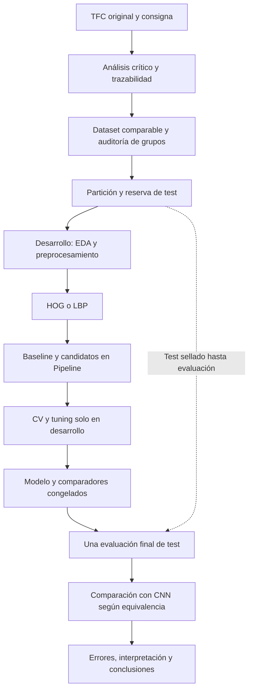

# Roadmap del TFI de Inteligencia Artificial II

**Equipo:** Juan Quirós y Andruszyszyn. **Fecha:** 09/10/2026. **Estado:** planificación previa a sprint 00; ninguna implementación o experimentación propia ejecutada.

Este proyecto estudiará si características explícitas de radiografías permiten construir una alternativa clásica defendible a la CNN del TFC de Vega Lencina y Armoa (2023). La recomendación inicial es comparar **HOG + SVM lineal** con **LBP + Random Forest**, usando **DummyClassifier** como baseline y regresión logística como referencia lineal adicional. La elección final dependerá de validación cruzada; no existe un ganador anticipado.

Leer junto con [Teoría y stack](TEORIA_Y_STACK.md), [Comparativa pedagógica](COMPARATIVA_TFC_VS_PROPUESTA.md), [Fuentes y trazabilidad](FUENTES_Y_TRAZABILIDAD.md) y [Ejecución](ejecucion/README.md). Las marcas **[A] TFC**, **[B] consigna**, **[C] propuesta** y **[D] hipótesis** separan evidencia y decisiones. [E] remite a bibliografía adicional registrada en Fuentes. Citas TFC: páginas PDF/impresas, no páginas de un artículo previo.

## 1. Contexto y requisitos [A, B]

El TFC nació en el contexto de pandemia y buscó apoyar el reconocimiento de signos en radiografías de tórax mediante una CNN. La motivación histórica fue la disponibilidad de radiografías y las dificultades de acceso o demora de pruebas de laboratorio (TFC pp. 6–7). No trasladaremos sus afirmaciones sanitarias históricas a recomendaciones médicas actuales.

La consigna pide analizar críticamente el TFC asignado, diseñar una solución distinta, justificar formalmente modelos, comparar una baseline más dos candidatos, implementar un pipeline reproducible y evaluar con test reservado. También exige interpretación, análisis de errores, ética y despliegue conceptual. No exige desarrollar una aplicación web ni superar una cifra de accuracy (TFI §§4–5). La matriz completa de requisitos, formato de informe, rúbrica y pendientes administrativos está en [Fuentes](FUENTES_Y_TRAZABILIDAD.md).

## 2. Reconstrucción del problema original [A]

**Autores:** Nuria Isabel Vega Lencina y Guido Sebastián Armoa. **Directora:** Mgter. Karina Eckert. **Año:** 2023. El documento completo tiene 103 páginas, incluidos código, entrenamientos y entrevistas.

El objetivo general fue desarrollar un prototipo que reconociera signos de COVID-19 en radiografías mediante CNN. Los objetivos específicos fueron establecer el estado del arte, analizar/diseñar la CNN, desarrollar el prototipo y validar resultados junto a un experto (p. 7). La tarea computacional fue clasificación binaria de imágenes; la etiqueta de infección, el signo radiográfico y el diagnóstico clínico no son conceptos equivalentes.

## 3. Datos originales y cuatro configuraciones [A]

La fuente fue **COVID-19 Radiography Database**, publicada en Kaggle por investigadores asociados a Qatar y Dhaka y colaboradores. Según pp. 32–33, son PNG de **299×299 píxeles**. Las clases originales suman **21164 imágenes** (suma documental): 3615 COVID, 10192 normales, 6012 opacidad pulmonar y 1345 neumonía viral.

El TFC atribuye las 3615 COVID a 2473 de PadChest, 183 de una escuela de medicina alemana, 559 de SIRM/GitHub/Kaggle/Tweeter y 400 de otra fuente GitHub. Las normales proceden de RSNA (8851) y Kaggle (1341); opacidad pulmonar de RSNA (6012); neumonía viral de Kaggle (1345). Esto reproduce la procedencia **declarada por el TFC**, sin certificar cada fuente. Los métodos de confirmación y la etapa de enfermedad no son homogéneos ni están detallados por imagen (p. 33).

| Dataset | COVID operativo | NO COVID operativo | Cantidad COVID / NO COVID; total | Depuración y motivo |
|---|---|---|---|---|
| D1 | COVID + neumonía viral + opacidad pulmonar | Normales | 10972 / 10192; **21164** | No. Aumentar ejemplos disponibles; etiquetas amplias |
| D2 | COVID + neumonía viral | Normales | 4960 / 4960; **9920** | No. Excluir opacidad por recomendación profesional y balancear normales; agrupación contextual de pandemia |
| D3 | Solo COVID | Normales | 3615 / 3615; **7230** | No. Hacer más específica la clase positiva |
| D4 | Solo COVID | Normales | 2462 / 2462; **4924** | Sí, revisión manual sin profesional disponible; retirar borrosidad, movimiento, elementos metálicos y errores de colimación |

Fuente: pp. 34–36, tabla 2. D4 conserva el criterio binario de D3 y elimina imágenes de calidad considerada deficiente. El artículo no proporciona en el PDF una lista reproducible de IDs retenidos/excluidos ni reglas cuantitativas de calidad. No podemos reconstruir exactamente el subconjunto con solo estas cantidades.

**Interpretación propia [C]:** en D4, NO COVID significa **normal**, no cualquier radiografía negativa para SARS-CoV-2. El modelo no queda evaluado frente a neumonías no COVID ni al conjunto de enfermedades que aparecen en una población clínica. En D1/D2 la ampliación de etiquetas cambia el problema: sus métricas no comparan exactamente la misma tarea que D4. El balance artificial tampoco representa prevalencia real.

### Partición original: lo declarado y lo verificable [A, C]

P. 33 declara **80 % entrenamiento, 10 % validación, 10 % prueba**. La tabla 3 p. 43 informa:

| Dataset | Validation COVID / NO COVID declarados | Test COVID / NO COVID declarados | Train por resta de tablas 2–3, **inferencia no verificada** |
|---|---|---|---|
| D1 | 1018 / 1018 | 1018 / 1018 | 8936 / 8156 |
| D2 | 496 / 496 | 496 / 496 | 3968 / 3968 |
| D3 | 361 / 361 | 361 / 361 | 2893 / 2893 |
| D4 | 246 / 246 | 246 / 246 | 1970 / 1970 |

Esos train son **cálculos condicionales**, no inventarios confirmados. En D1, 1018 no es el 10 % de 10972: suponiendo las tablas, validation y test son aproximadamente 9,28 % de positivos y 9,99 % de negativos. Además, figura 32 p. 47 suma **495/496** en test D2, y figura 35 p. 50 suma **362/362** en D3; divergen de tabla 3. D4 sí muestra 246/246 en figura 38 p. 53. No existe evidencia para determinar exactamente todos los IDs y conteos efectivos de train/validation/test. La respuesta rigurosa al pedido de exactitud es preservar estas divergencias y solicitar manifiestos en 00–01.

## 4. CNN, entrenamiento y stack original [A]

La reconstrucción técnica prioriza anexos I–II, pp. 68–72, frente a simplificaciones de diagramas. La red tiene **tres convoluciones y dos MaxPooling**, no tres pooling.

| Etapa | Configuración | Salida / parámetros |
|---|---|---|
| Entrada | Grises, un canal | 299×299×1 |
| Conv1 | 32 filtros 3×3, `same`, ReLU | 299×299×32; 320 parámetros |
| MaxPooling1 | 2×2 | 149×149×32 |
| Conv2 | 64 filtros 2×2, `same`, ReLU | 149×149×64; 8256 |
| MaxPooling2 | 2×2 | 74×74×64 |
| Conv3 | 64 filtros 2×2, `same`, ReLU | 74×74×64; 16448 |
| Flatten | Aplanamiento sin aprendizaje | 350464 valores |
| Dense | 64 neuronas, ReLU | 22429760 |
| Dropout | Probabilidad 0,5 durante entrenamiento | 64 |
| Dense salida | 2 neuronas, Softmax | 130 |
| Total | Todos entrenables | **22454914 parámetros** |

Las convoluciones aprenden patrones locales; ReLU introduce no linealidad; pooling reduce resolución; Flatten conecta mapas con Dense; Dropout regulariza; Softmax produce dos puntuaciones normalizadas. Softmax **no garantiza probabilidades calibradas ni porcentajes de acierto individual**. La capa Dense concentra casi todo el volumen paramétrico; es una motivación concreta para explorar otra representación.

Entrenamiento: `categorical_crossentropy`, Adam, learning rate **0,0005**, batch **32**, **20 épocas**, `class_mode='categorical'`, `fit_generator`. Train y validation usan `/255`; solo train aplica `shear_range=0.3`, `zoom_range=0.3` y `horizontal_flip=True`. Los pasos se calculan por división entera del número de imágenes entre batch, con posible omisión de remanentes por época; no se detalla su efecto. Se guardan `modelo.h5` y `pesos.h5` (pp. 68–71).

| Herramienta original | Uso documentado |
|---|---|
| Python, Anaconda | Lenguaje y gestión de entorno |
| TensorFlow / Keras | Construcción, entrenamiento y carga CNN; mezcla de imports internos de TensorFlow y Keras |
| NumPy | Arreglos y `argmax` de predicciones |
| Matplotlib | Curvas y figuras |
| scikit-learn | Matriz y reporte de clasificación |
| mlxtend.plotting | Visualización de matriz |
| os | Directorios y almacenamiento |

No hay un archivo de entorno con versiones exactas en el PDF. El hardware declarado es notebook con **16 GB RAM, SSD, Intel Core i7-7700HQ 2,80 GHz**; no se identifica una GPU utilizada. El texto informa entrenamientos de **40 minutos a 6 horas**, según dataset (p. 36); no es una tabla de benchmarks normalizados por ensayo. El anexo V tiene tiempos por época variables; no usarlos como medición directa comparable con hardware nuevo.

## 5. CRISP-ML(Q) original [A] y adaptación [C]

El marco contiene entendimiento del negocio/datos, preparación, modelado, evaluación, despliegue y monitoreo/mantenimiento. El TFC excluye las dos últimas fases por tratarse de prototipo y describe iteración entre datos y modelos (pp. 29–32). Su fortaleza es organizar decisiones y evaluación. La metodología por sí sola no garantiza calidad: necesita controles verificables.

Reutilizaremos las cuatro primeras fases con manifiestos, controles contra leakage y evidencias. Cubriremos despliegue, monitoreo y mantenimiento **conceptualmente** porque lo exige TFI §5.7, sin desarrollar infraestructura. Véase [E15](FUENTES_Y_TRAZABILIDAD.md).

## 6. Las doce pruebas originales [A]

Tres entrenamientos por configuración, doce en total (p. 43). **No son 12 folds de validación cruzada.** Los pares de cada columna son **COVID / NO COVID**, métricas entre 0 y 1; accuracy es global en test. Transcripción de tabla 17 p. 57, contrastada con tablas 4–15 pp. 44–55.

| Dataset | Prueba | Precision C / N | Recall C / N | F1 C / N | Accuracy | Observación propia [C] |
|---|---:|---|---|---|---|---|
| D1 | 1 | 0,6667 / 0,7757 | 0,8310 / 0,5845 | 0,7398 / 0,6667 | 70,78 % | FP relevantes |
| D1 | 2 | 0,5804 / 0,8560 | 0,9470 / 0,3153 | 0,7197 / 0,4609 | 63,11 % | Mayor inclinación hacia positivo |
| D1 | 3 | 0,5142 / 0,9118 | 0,9941 / 0,0609 | 0,6778 / 0,1142 | 52,75 % | Casi no reconoce normales |
| D2 | 4 | 0,4995 / 0,5000 | 0,9455 / 0,0544 | 0,6536 / 0,0982 | 49,95 % | Desempeño cercano a clase constante |
| D2 | 5 | 0,4945 / 0,4400 | 0,9152 / 0,0665 | 0,6421 / 0,1156 | 49,04 % | Ambas clases mal separadas |
| D2 | 6 | 0,4995 / 0,0000 | 1,0000 / 0,0000 | 0,6662 / 0,0000 | 49,95 % | Predice todos positivos |
| D3 | 7 | 0,5142 / 0,9545 | 0,9972 / 0,0580 | 0,6786 / 0,1094 | 52,76 % | Recall alto no implica utilidad global |
| D3 | 8 | 0,5385 / 0,8378 | 0,9669 / 0,1713 | 0,6917 / 0,2844 | 56,91 % | Persisten muchos FP |
| D3 | 9 | 0,4794 / 0,4727 | 0,5470 / 0,4061 | 0,5110 / 0,4368 | 47,65 % | Gran brecha validation/test |
| D4 | 10 | 0,7912 / 0,7984 | 0,8008 / 0,7886 | 0,7960 / 0,7935 | **79,47 %** | Mejor test reportado |
| D4 | 11 | 0,6579 / 0,6858 | 0,7114 / 0,6301 | 0,6836 / 0,6568 | 67,07 % | Inferior a prueba 10 |
| D4 | 12 | 0,6667 / 0,6549 | 0,6423 / 0,6789 | 0,6542 / 0,6667 | 66,06 % | Variación entre entrenamientos |

### Validation no es test

| Prueba | Accuracy train | Accuracy validation | Accuracy test |
|---|---:|---:|---:|
| 1 | 0,8292 | 0,8552 | 0,7078 |
| 2 | 0,8478 | 0,8725 | 0,6311 |
| 3 | 0,8511 | 0,8730 | 0,5275 |
| 4 | 0,8715 | 0,6099 | 0,4995 |
| 5 | 0,8806 | 0,6069 | 0,4904 |
| 6 | 0,8752 | 0,6633 | 0,4995 |
| 7 | 0,8009 | 0,8920 | 0,5276 |
| 8 | 0,8009* | 0,8920* | 0,5691 |
| 9 | 0,8387 | 0,9034 | 0,4765 |
| 10 | 0,8410 | 0,8208 | 0,7947 |
| 11 | 0,8122 | 0,8562 | 0,6707 |
| 12 | 0,7909 | 0,8375 | 0,6606 |

Fuente: tablas 16–17 pp. 56–57. *En prueba 8, tabla 16 y tabla 25 repiten la prueba 7; el log de época 20 p. 91 informa train=0,8581, validation=0,8906, train loss=0,3219 y validation loss=0,2650. Se conserva la discrepancia. No se debe llamar “90 % de rendimiento final” al 90,34 % de validation de prueba 9: su test fue 47,65 %.

### Resultado principal: prueba 10 de D4

La figura 38 p. 53 contiene, con COVID como positivo, **VP=197, FN=49, FP=52, VN=194**, total 492. Es coherente con 391/492≈79,47 %. Sensibilidad 80,08 %, especificidad 78,86 %, precision positiva 79,12 % y F1 positivo 79,60 %. La especificidad es el recall de la clase NO COVID. Estas son cifras del TFC o cálculos directos de su tabla; no resultados nuestros.

El TFC atribuye la mejora a depuración (p. 61), pero **[C] esa atribución causal no queda aislada**: cambiaron imágenes, tamaño y posiblemente particiones, con variabilidad aleatoria. Tres ensayos no separan esos efectos. El 75 % considerado viable surge de la entrevista p. 102; es un criterio contextual del profesional, no una certificación clínica ni nuestro umbral de aprobación.

## 7. Validación profesional [A] y alcance [C]

Se seleccionaron **52 radiografías del test**, no una cohorte externa, y participó un solo médico, Dr. Osvaldo Luqui, R4 en diagnóstico por imágenes (pp. 43, 58–59; anexo VI pp. 100–101).

| Comparación | Evidencia original | Lectura correcta |
|---|---|---|
| Médico frente a red | 37 coincidencias, 12 discrepancias, 3 indefinidas | 37/49≈75,51 % entre casos clasificables; el texto redondea a 75 %. No dividir por 52 para obtener esa concordancia |
| Red frente a etiquetas | VP19, VN22, FP6, FN5 | 41/52≈78,85 % de aciertos; 24 positivos y 28 negativos |
| Médico frente a etiquetas | VP16, VN21, FP4, FN8 | 37/49≈75,51 % entre definidos; abstención 3/52 |

Los casos indefinidos son 10, 35 y 39 y tienen etiqueta NO COVID; la red acierta dos de ellos. En los **mismos 49 casos**, la red acierta 39 (reconstrucción documental del anexo). No comparar 41/52 y 37/49 como prueba de superioridad. La coincidencia médico/red tampoco es exactitud frente a etiquetas: ambos pueden equivocarse de la misma manera.

El análisis de fallos p. 60 identifica, según el profesional, signos de enfermedad crónica/complicaciones en algunos FN; para FP no halló patrón común y sugirió errores aleatorios o mala técnica. No son demostraciones etiológicas. El estudio es pequeño, con selección no descrita como aleatoria y sin varios lectores: aporta revisión cualitativa, no validación clínica generalizable. La “validación cruzada” mencionada para múltiples médicos p. 59 alude a acuerdo entre lectores y no equivale a K-fold de ML.

## 8. Fortalezas, límites y análisis crítico [A, C]

Fortalezas: problema explícito, dataset público identificado, arquitectura y código anexados, métricas por clase, doce entrenamientos, reconocimiento de errores y consulta profesional. Permiten una crítica verificable y una alternativa concreta.

**Limitaciones explícitas de autores** (pp. 60–62): calidad/técnica radiográfica; afecciones crónicas que dificultan clasificación; alto costo computacional y tiempos; compatibilidad/portabilidad entre bibliotecas; restricciones de contacto profesional durante emergencia sanitaria. Trabajos futuros: multiclase, transferencia ResNet/VGG, mejorar dataset con profesional y evaluación real con interfaz. Esas extensiones no pasan automáticamente a nuestro alcance.

| Evidencia | Implicancia metodológica propia | Clasificación |
|---|---|---|
| D1/D2 reúnen patologías bajo COVID, pp. 34–36 | La etiqueta operativa no es infección confirmada; restringe comparación entre datasets | Decisión metodológica |
| Fuentes heterogéneas, p. 33 | Textos, equipos o procedencia podrían correlacionarse con clase; verificar por fuente | Posible limitación |
| Sin fecha/estadio preciso por imagen, p. 33 | Infección y signos visibles pueden diferir; etiqueta ruidosa para tarea visual | Limitación confirmada de metadatos |
| D4 limpiado sin experto, p. 35 | Puede excluir casos difíciles y cambiar población; “menos sesgo” no está demostrado | Decisión metodológica y posible limitación |
| Normales como única clase negativa de D4 | No evalúa diagnóstico diferencial ante otras patologías | Limitación confirmada del alcance |
| Balance artificial y D1 no exactamente balanceado | Accuracy y precision dependen de composición; no trasladar prevalencia | Decisión metodológica |
| No hay IDs/pacientes/semillas del split en PDF | No puede auditarse independencia; duplicados/pacientes repetidos son riesgos, no hechos probados | Posible limitación |
| Conteos divergentes de tablas/matrices | Replicación exacta no garantizada solo con PDF | Limitación confirmada de documentación |
| Se elige prueba 10 por mejor clasificación en test, pp. 43,58 | Test participa en selección; el mejor valor tiene sesgo de selección potencial | Decisión metodológica; limitación para estimación final independiente |
| 3 entrenamientos por dataset; no CV experimental documentada | No se estima robustez a distintas particiones ni se aísla azar | Oportunidad de mejora |
| `/255` en entrenamiento pero no anexo IV, pp. 68,75 | Diferencia de distribución entre entrenamiento e inferencia; no se sabe si ejecución real fue igual | Inconsistencia confirmada en código publicado |
| Predicción individual sin grayscale explícito, p. 73 | Posible incompatibilidad de canales con entrada de un canal | Posible limitación de reproducibilidad |
| Prueba 9: 90,34 % validation vs 47,65 % test | Auditar preprocesamiento, mapeo, selección y particiones antes de atribuir solo sobreajuste | Oportunidad de mejora |
| No búsqueda sistemática de hiperparámetros ni semillas documentadas | No se conoce sensibilidad del modelo a configuración/azar | Oportunidad de mejora |
| Sin prueba estadística de comparación reportada | No afirmar mejora estadísticamente significativa de D4 | Limitación confirmada de evaluación reportada |
| Sin explicaciones del modelo por imagen/feature | Opinión sobre fallos no revela mecanismo aprendido | Oportunidad de mejora |
| Un profesional, 52 imágenes del mismo test | Acuerdo limitado; ausencia de validación externa/multilector | Limitación confirmada |
| Dense de 22,43 millones de pesos y notebook, pp. 36,72 | Motiva medir alternativas; no prueba que todo ML clásico sea barato | Oportunidad de mejora |
| Imports mixtos sin lock de entorno, pp. 68–75; portabilidad p. 61 | Reconstrucción puede fallar con versiones actuales | Limitación confirmada de documentación |

La crítica más útil es convertir cada incertidumbre en un control futuro: manifiestos, pipeline único y evaluación separada. No atribuir data leakage entre pacientes ni aprender “marcas de hospital” como un hecho del TFC sin datos que lo prueben. El estudio de DeGrave et al. [E16] motiva investigar atajos, no demuestra que ocurrieran aquí.

## 9. Pregunta, hipótesis y objetivos propios [C, D]

La pregunta inicial une tres promesas ambiguas: “competitivo”, “menor costo” y “más interpretable”. Además, una cifra histórica no basta para comparación controlada. Proponemos:

> En radiografías etiquetadas COVID-19 y normales de una configuración trazable equivalente a D4, ¿qué desempeño, costo computacional y posibilidades de interpretación ofrece un pipeline clásico con HOG/LBP frente a una baseline y otros candidatos, y qué comparación permite con la CNN original según la equivalencia efectiva de datos y evaluación?

Así mantenemos la alternativa al TFC sin prometer superioridad o validez clínica. “Competitivo” se discutirá como balance observado de **F1 macro, sensibilidad, especificidad y costo**; no como no inferioridad estadística sin margen predefinido y potencia adecuada.

**Hipótesis D1:** HOG/LBP contienen señal suficiente para superar la referencia trivial en evaluación independiente. **D2:** el pipeline lineal puede demandar menos recursos que la CNN descrita. **D3:** la relación entre descriptores y decisiones puede explicarse más directamente en un modelo lineal. Todas pueden resultar falsas. Si no se dispone de CNN comparable, D2 solo podrá contrastarse parcialmente; no se confundirá sencillez conceptual con explicación clínica.

**Objetivo general:** diseñar, implementar y evaluar posteriormente una alternativa clásica reproducible, fundamentando sus diferencias y límites frente al TFC.

Objetivos específicos: reconstruir evidencia original; auditar datos/etiquetas y reservar test; construir descriptores reproducibles; comparar baseline y candidatos; ajustar solo en desarrollo; medir errores e incertidumbre; estudiar interpretabilidad y recursos; producir informe y defensa comprensibles para ambos integrantes.

### Formulación formal

Entrada `x`: imagen de tórax en grises, dominio de píxeles y resolución definidos. Etiqueta `y∈{0,1}`, con **1=COVID, 0=normal/NO COVID operativo**. Un descriptor fijo `φ(x)∈R^d` alimenta un clasificador `fθ`; scaler y PCA, si existen, aprenden solo de train. Se minimiza la función de entrenamiento correspondiente a cada familia (teoría) y se selecciona configuración por **F1 macro medio en CV**. No confundir función de costo del algoritmo con métrica de selección.

## 10. Pipeline y alternativas [C]



Preprocesamiento inicial propuesto: carga validada, grises, resize fijo **128×128**, tipo numérico/rango explícitos, sin aumentación ni filtros clínicos. Esta resolución es un punto inicial por costo, no un óptimo ni una copia de los 299×299 originales. Variantes deben decidirse en desarrollo y quedar congeladas antes de test. Mantener proporción si cambia la forma de entrada; documentar padding/recorte. No aprender estadísticas globales ni aplicar limpieza guiada por aciertos.

| Combinación | Adecuación, dimensión y costo | Generalización / interpretación | Decisión |
|---|---|---|---|
| A: HOG → StandardScaler → SVM lineal | Bordes locales; 8100 features con 128², celdas 8², bloques 2² y 9 bins. Inferencia producto escalar; fit razonable pero depende de n/d | Margen regularizado, pesos inspeccionables; sensible a artefactos y alineación | **Candidato principal C1**, sin declararlo ganador |
| B: HOG → scaler → PCA → SVM | Menos columnas puede reducir costo posterior; PCA tiene costo propio. Con RBF fit crece fuertemente con n y memoria | Puede eliminar señal de poca varianza; componentes dificultan explicación | Ablación PCA de C1; RBF opcional y acotado por presupuesto |
| C: LBP → Random Forest | Histograma compacto de textura; árbol por bootstrap y submuestreo de features; sin necesidad de scaler | No lineal, regularizar profundidad/hojas; importancia no causal | **Candidato C2** con representación distinta |
| C alternativa: HOG o HOG+LBP → RF | Posible combinación de forma/textura, mucho mayor dimensión y correlación | Dificulta separar efectos del descriptor/modelo | Comparación controlada opcional, no producto cartesiano completo |
| D: LBP → scaler → KNN | Fit casi almacenamiento; inferencia recorre vecinos, costo y memoria dependen de n | Explica vecinos similares pero similitud no equivale a causa; sufre alta dimensión | Candidato opcional pedagógico, con k y distancia controlados |
| E: DummyClassifier `most_frequent` | Ignora imagen y aprende clase más frecuente en train | Referencia mínima; no evidencia de señal visual | **Baseline B0 obligatoria** |
| HOG → scaler → regresión logística L2 | Referencia lineal con log-loss, puntuación probabilística | Coeficientes y regularización; sin calibración garantizada | **Referencia B1 adicional recomendada**, además de C1/C2 |

No llamar a B1 la única baseline para ocultar B0. Comparar HOG-SVM y LBP-RF evalúa **pipelines completos**: no permite atribuir toda diferencia solo al clasificador. Para aislar factores, extensión pequeña predefinida: HOG-RF frente a HOG-SVM o LBP-SVM frente a LBP-RF; justificar costo antes de ejecutarla.

LBP inicial: `uniform`, P=8, R=1, histogramas normalizados por celdas de una grilla 4×4; P+2=10 bins por celda, total **160** valores. El mapa LBP no es por sí mismo un vector de longitud independiente del tamaño; se agrega por histogramas. HOG/LBP no se ajustan con etiquetas, pero elegir sus parámetros sí forma parte de selección en desarrollo.

## 11. Datos para la alternativa y condiciones de comparación [C]

Preferimos el **criterio de etiquetas de D4**, porque corresponde a la mejor referencia binaria del TFC. La equivalencia exacta queda condicionada a obtener versión del dataset, IDs de imágenes, exclusiones, grupos/pacientes y particiones originales. Repetir depuración “a ojo” hasta obtener 2462 por clase **no reconstruye D4** y puede seleccionar casos fáciles.

Tres niveles de comparación:

1. **Histórica contextual (mínimo viable):** comparar nuestros resultados con cifras publicadas, describiendo diferencias de datos, limpieza, split, hardware y preprocesamiento. Sin pruebas pareadas contra el 79,47 %.
2. **Misma población, nuevo split:** subconjunto equivalente y partición nueva segura. Mejora comparabilidad de tarea; no es réplica exacta del test original.
3. **Controlada:** mismas imágenes/grupos y test independiente para ambos modelos, entrenamiento compatible, predicciones individuales y medición en el mismo hardware. Solo entonces puede haber comparación pareada. Reentrenar una CNN es una ampliación futura que requiere decisión explícita, no parte automática de estos sprints.

Un modelo CNN entrenado previamente no puede evaluarse sobre un nuevo test si se desconoce si ya vio esas imágenes. Usar el test histórico también hereda la selección previa del TFC; declararlo como conjunto históricamente utilizado, sin venderlo como validación externa intacta.

Si no se recuperan IDs de D4, documentar la imposibilidad, proponer subconjunto nuevo con reglas verificables y obtener autorización de cátedra cuando se trate de datos públicos equivalentes sustitutos (TFI §4). Preservar la limitación en el informe. No es necesario inventar equivalencia para completar un TFI riguroso.

## 12. Validación y prevención de fuga [C]

**Protocolo por defecto:** separar aproximadamente **80 % desarrollo y 20 % test** una sola vez, con semilla 42 y estratificación si es compatible con grupos. Dentro de desarrollo, **5 folds** para comparación y tuning; cada fold usa cuatro partes como train y una como validation. No añadimos otro holdout de validación fijo. Cada ajuste usa aproximadamente 64 % del total para train y 16 % para validation; al seleccionar, se reentrena en el 80 % completo. Estos son porcentajes propuestos, distintos del 80/10/10 histórico.

Prioridad: independencia por paciente/estudio y duplicados por encima de porcentajes exactos. Si hay pacientes repetidos, holdout agrupado y `StratifiedGroupKFold` cuando sea factible. Si faltan IDs, agrupar duplicados exactos y sospechosos confirmados; eso no acredita independencia de pacientes. Si no hay suficientes grupos por clase para cinco folds, reducir k con justificación **antes del modelado** y compartir mismos folds entre métodos. Sin grupos conocidos, `StratifiedKFold(n_splits=5, shuffle=True, random_state=42)` con limitación explícita.

Controles previos al sellado: archivos corruptos, hashes, duplicados, etiquetas conflictivas, metadatos de procedencia y reglas de elegibilidad. Esa auditoría estructural puede abarcar el inventario completo para evitar cruce de duplicados; **no permite explorar patrones predictivos del test**. Después, EDA y decisiones de calidad/representación se hacen en desarrollo. Una exclusión necesaria descubierta tarde implica registrar incidencia y reevaluar validez, no cambiar silenciosamente test.

Cada fold ajusta `StandardScaler`, PCA, selección de features o imputación **solo en su train** mediante `Pipeline`. Un scaler ajustado con todo el desarrollo antes de CV filtra información de validation aun si no usó test. Extraer HOG fijo por imagen puede cachearse por hash+configuración; cachear PCA ajustado antes de folds no. Balanceo por pesos se calcula dentro del fit; cualquier remuestreo se limitaría a train, aunque no se propone inicialmente.

No utilizar test para elegir extractor, resolución, modelo, PCA, umbral, hiperparámetros, exclusiones por desempeño ni calibración. Conservar manifiesto con hash y registro de accesos. Pipeline no impide por sí solo pacientes repetidos o intervención humana basada en test.

## 13. Comparación, CV y tuning [C]

Sprint 04 compara configuraciones iniciales fijas en los mismos folds. Sprint 05 ajusta las familias principales; baseline y B1 se reportan sobre esos mismos folds. Guardar por fold F1 macro, precision/recall/F1 de cada clase, accuracy, especificidad, ROC-AUC y AP cuando haya scores válidos, junto con train score, tiempos y fallos. Resumir **media ± desvío estándar muestral (ddof=1)**; no interpretarlo como intervalo de confianza por independencia.

El mejor promedio de una búsqueda CV es una estimación de **selección**, potencialmente optimista. El test final estima generalización del pipeline elegido. CV anidada sería una extensión justificable si se necesita estimar sin ese optimismo el proceso completo de tuning; no añadirla por costumbre ni aplicar estadística ingenua sobre los folds de búsqueda.

| Familia | Espacio preliminar de tuning | Motivo |
|---|---|---|
| SVM lineal | C∈{0,01;0,1;1;10}; pesos∈{None,balanced} | Compromiso margen/errores; costos por clase |
| PCA + SVM | PCA `passthrough` frente a 0,95 de varianza, solver compatible con fracción | Contrastar reducción con su ausencia; no asumir beneficio |
| RF sobre LBP | 200 árboles; max_depth∈{None,10,20}; min_samples_leaf∈{1,3,5}; max_features∈{sqrt,0.5} | Capacidad y regularización; 18 configuraciones |
| Logística B1 | C∈{0,1;1;10}; penalización L2; convergencia comprobada | Referencia lineal regularizada |
| KNN opcional | k∈{3,5,11,21}, weights∈{uniform,distance}, p∈{1,2} | Vecindad, ponderación y geometría |
| RBF opcional | C y gamma en escalas logarítmicas; ≤12 sorteos | No linealidad a costo controlado |

Propuesta base: 8 configuraciones SVM sin PCA y 8 con PCA, 18 RF y 3 logística: **37×5=185 ajustes CV**, más baselines, reentrenamientos y exploración previa. Son cálculos de presupuesto, no ejecuciones. HOG/LBP y resolución permanecen fijos en esta búsqueda inicial. Un cambio amplía presupuesto y debe registrarse antes de test. `GridSearchCV` para grillas pequeñas; `RandomizedSearchCV` con semilla y `n_iter` para rangos amplios. No ejecutar todas las alternativas opcionales por defecto.

Seleccionar al final de 05 por F1 macro medio; para empate práctico predefinido de **≤0,005** en F1, preferir menor tiempo total de ajuste y después menor tamaño de artefacto. Esa tolerancia es operativa, no equivalencia estadística ni margen clínico. Reportar siempre sensibilidad/especificidad aunque el seleccionado no lidere ambas. Congelar umbral estándar (0 para decision_function; 0,5 para probabilidad binaria) y registrar regla de empates. Si se propone modificarlo, validarlo únicamente en desarrollo antes del cierre 05.

## 14. Evaluación, métricas y comparación CNN [C]

Sprint 06 consume por primera vez el test para un **único lote de evaluación** de final y comparadores precongelados (B0, B1 si se incluyó y dos candidatos). La elección ya está hecha; si otro candidato obtiene mejor test, no cambiar ganador. Guardar una vez predicciones/scores por ID; cálculos y gráficos posteriores reutilizan ese archivo. No abrir test por separado durante diseño.

| Métrica | Qué responde y por qué conservarla |
|---|---|
| Matriz VP/VN/FP/FN | Muestra errores absolutos, clase positiva explícita y tamaño de muestra |
| F1 macro | Criterio principal de selección: peso igual a ambas clases |
| Precision COVID | Qué fracción de predicciones COVID coincide con etiqueta positiva |
| Recall/sensibilidad COVID | Qué fracción de positivos etiquetados recupera |
| Especificidad | Qué fracción de normales no marca como COVID |
| F1 por clase y accuracy | Equilibrio precision/recall y referencia descriptiva al TFC |
| ROC y ROC-AUC | Discriminación a través de umbrales usando scores, no solo etiquetas |
| PR y Average Precision (AP) | Tradeoff de recuperación y precision; útil ante desbalance. Informar prevalencia y distinguir AP de área trapezoidal PR |

Un FN clasifica como normal una imagen etiquetada COVID; en un uso indebido podría generar falsa tranquilidad. Un FP marca como COVID una normal y podría originar evaluación innecesaria. Estas son implicancias potenciales, no recomendaciones de diagnóstico. La etiqueta del dataset no certifica por sí sola hallazgos visibles ni estado clínico actual.

Comparación de costo: medir extracción, ajuste final, búsqueda total, inferencia completa por imagen/lote (lectura+preprocesamiento+features+clasificador), pico RAM, CPU/hilos, tamaño serializado, versiones y hardware. Registrar calentamiento y mediana/p95 de latencia con repeticiones fijadas, sin repetir decisiones sobre test. No comparar una inferencia SVM sin extracción con CNN de extremo a extremo. Interpretabilidad: complejidad del modelo, posibilidad de asociar coeficientes a regiones y estabilidad de explicaciones; no un eslogan de “caja blanca”.

CNN histórica: accuracy/precision/recall/F1 disponibles; especificidad derivable de matriz; AUC, latencia controlada, RAM pico y bytes de artefacto **no reportados de manera comparable**. Usar “no disponible”, nunca cero. Sin ejecución equivalente no afirmar ahorro medido respecto a 40 minutos–6 horas.

## 15. Estadística propuesta [C]

Primero reportar diferencias de tamaño de efecto e incertidumbre. No hacer que un p-valor decida el ganador tras test. Para intervalos de métricas finales puede planificarse bootstrap pareado de predicciones congeladas, por paciente/grupo si corresponde; fijar semilla, 2000 remuestreos y método percentil antes de apertura. No implica reentrenar o consultar de nuevo el test. Con pocos grupos o una clase ausente en remuestreos, informar la limitación y método de tratamiento predefinido.

| Método | Comparación permitida | Supuestos / decisión para este proyecto |
|---|---|---|
| McNemar | Dos clasificadores fijos en las **mismas instancias**, tabla de aciertos discordantes b/c | Pares independientes entre pacientes; exacta binomial sobre b+c si muestra pequeña. No compara AUC ni magnitud F1. No puede calcularse con dos accuracies publicadas |
| Wilcoxon de rangos con signo | Diferencias pareadas de rendimiento en unidades independientes, distribución de diferencias aproximadamente simétrica | Folds comparten entrenamiento: cinco folds de este único dataset no son cinco experimentos independientes. No aplicarlo automáticamente |
| t pareado 5×2cv | Comparación de algoritmos bajo cinco divisiones 50/50 y sus intercambios | Diseño específico, diez entrenamientos por algoritmo, ajustar tuning sin contaminación. No es el t-test común de cinco folds; extensión fuera del protocolo básico |

Fuentes [E17–E20](FUENTES_Y_TRAZABILIDAD.md). McNemar es la opción preferida **si** hay pares válidos; contraste primario propuesto: final frente a B0 en el test único, α=0,05 bilateral, definido antes de abrirlo. Una comparación adicional con CNN solo si hay predicciones sobre ese mismo test y entrenamiento independiente. Si se agregan múltiples contrastes, definir familia y ajuste Holm antes de evaluación. Si faltan independencia o datos pareados, justificar la omisión del test estadístico y reportar evidencia descriptiva; “no significativo” no prueba igualdad. No se aplica ninguna prueba ahora.

## 16. Interpretabilidad y análisis de errores [C]

En 07 se estudian FP/FN y aciertos con un protocolo de muestreo que evite elegir solo imágenes convenientes. Registrar calidad, procedencia y subgrupos disponibles, sin inferir edad/sexo ni diagnóstico por apariencia. Examinar si errores se concentran en artefactos, calidad o fuente, distinguiendo observación de explicación hipotética.

SVM lineal/logística: mapear coeficientes a bloques/bins HOG y documentar efecto del escalado; un peso no es una lesión localizada. Si hay PCA, los coeficientes en componentes requieren retroproyección con escalas para asociarse al descriptor original. RF: importancia por impureza solo orientativa; preferir permutación repetida por **grupos de descriptores/regiones** en datos de desarrollo retenidos o fuera de fold. Correlación puede repartir/ocultar importancia. KNN: mostrar vecinos de train sin convertir similitud en explicación clínica. SHAP queda fuera del mínimo: incorporarlo solo si responde una pregunta que estas técnicas no resuelven y hay presupuesto.

Después del test, cualquier propuesta de mejora va a trabajo futuro. El análisis descriptivo de errores reutiliza predicciones de 06; no permite volver a seleccionar modelos.

## 17. Reproducibilidad, stack y estructura futura [C]

Python con venv; NumPy, pandas, Matplotlib, scikit-image y scikit-learn; Jupyter como apoyo de exploración; Git/GitHub para documentación, código, configuraciones y resultados pequeños. SciPy ya acompaña al stack y podrá aportar estadística justificada; no agregar statsmodels solo por McNemar si una prueba binomial exacta de SciPy cubre el cálculo validado. No necesitamos TensorFlow/PyTorch, frontend, API, base de datos, Docker, cloud, MLflow ni Kubernetes para este alcance. La explicación de elecciones y alternativas está en teoría.

Semillas separadas registradas para split, folds, modelos, búsqueda y remuestreo (base 42 como propuesta). Fijar versiones **realmente comprobadas** en 01; no inventar hoy un requirements compatible. Registrar OS, CPU, RAM, hilos, commit, versión y hash de dataset, licencia, manifiestos de partición, configuración, exclusiones, scores y comandos. Semilla sola no asegura identidad entre equipos/versiones. No versionar radiografías, secretos ni binarios pesados. IDs/manifiestos publicados deben ser no identificatorios y compatibles con licencia.

```text
ia2-covid-xray-ml/
├── README.md
├── requirements.txt                # futuro, versiones comprobadas
├── .gitignore
├── configs/                       # JSON: datos, modelos, protocolo
├── data/
│   ├── raw/                       # local e inmutable
│   ├── processed/                 # local, derivados y cache
│   └── manifests/                 # IDs publicables y hashes; sin datos personales
├── notebooks/                     # EDA reproducible
├── src/
│   ├── data/
│   ├── features/
│   ├── models/
│   └── evaluation/
├── tests/                         # controles de contratos e independencia
├── models/                        # artefactos locales, ignorados
├── results/
│   ├── metrics/
│   ├── figures/
│   └── reports/
└── docs/
    ├── ROADMAP_TFI.md
    ├── TEORIA_Y_STACK.md
    ├── FUENTES_Y_TRAZABILIDAD.md
    └── ejecucion/
```

Es una estructura futura: en esta etapa solo se crean documentos y `.gitignore`. Los archivos de resultados solo se crearán con ejecuciones reales.

## 18. Riesgos, ética y despliegue conceptual [C]

| Riesgo | Control y responsable de resolver |
|---|---|
| D4 irreproducible o licencia incierta | Equipo verifica procedencia/IDs/licencia en 00–01; cátedra autoriza sustitución si aplica |
| Pacientes/duplicados cruzados | Auditoría y splits agrupados; documentar riesgo residual sin IDs |
| Sesgo de procedencia | Tablas por fuente y análisis estratificado si metadatos lo permiten |
| Descriptor aprende bordes/texto ajenos a pulmón | EDA en desarrollo, visualización y análisis de errores; no prometer segmentación |
| Selección manual de casos fáciles | Reglas previas, registro de exclusiones, no filtrar según aciertos |
| Búsqueda excesiva o RBF costoso | Presupuesto de fits/RAM y grillas acotadas; reducir antes de test |
| Información clínica no representativa | Describir población y clases restringidas; no inferir equidad no medida |
| Resultado inferior al original o baseline | Es un resultado científico válido si protocolo y explicación son sólidos |
| Uso indebido como diagnóstico | Identificar siempre prototipo académico y límites |

El sistema **no reemplaza diagnóstico médico, evaluación clínica, pruebas diagnósticas oficiales ni criterio profesional**. Datos históricos de pandemia pueden diferir en prevalencia, equipos, protocolos, selección de pacientes y enfermedades concomitantes; un test interno no mide generalización actual. No publicar imágenes identificatorias ni pedir acceso clínico adicional en esta etapa. La declaración de IA generativa es obligatoria y los estudiantes responden por cada cifra, fuente y decisión.

Despliegue conceptual: una función local carga un pipeline versionado y valida formato, tamaño/rango y clase; devuelve clasificación académica y score con sus límites. Registrar errores de entrada, versión y tiempos sin datos personales. Un despliegue real exigiría validación y gobernanza fuera de este TFI. Monitoreo conceptual: distribución de entrada/calidad/fuentes (data drift), rendimiento cuando haya etiquetas fiables (model drift), política de revisión humana antes de reentrenar, nueva evaluación y posibilidad de volver a versión anterior. No automatizar reentrenamientos ante cualquier cambio de histograma.

## 19. Criterios de éxito y alcance [C]

Éxito académico significa: trazabilidad del análisis; baseline y dos candidatos realmente comparados; particiones auditables; transformaciones dentro de folds; test usado una vez; resultados regenerables; métricas y costos honestos; interpretación con límites; informe conforme a consigna; ambos integrantes capaces de explicar todo. **No se impone superar 79,47 %** ni se prometen reducciones de costo.

Dentro de alcance: clasificación supervisada binaria, HOG/LBP, modelos clásicos acotados, PCA como ablación pertinente, CV/tuning, estadística condicionada a supuestos, ética y despliegue conceptual. Fuera: diagnóstico clínico, nuevas CNN/transfer learning, segmentación entrenada, clasificación multiclase, aplicación productiva, recolección hospitalaria, infraestructura MLOps y ensayos clínicos. No se implementa nada de esto ahora.

Resultado esperado: un estudio reproducible que indique qué enfoque funciona mejor **bajo las condiciones efectivamente evaluadas**, incluyendo resultados negativos e incertidumbres. Los campos de desempeño propio permanecen pendientes hasta 06; las conclusiones finales solo se escribirán después.

## 20. Roadmap por etapas [C]

| Sprint | Entrega futura | Dependencia / frontera |
|---|---|---|
| [00 Análisis](ejecucion/SPRINT_00_ANALISIS_TFC.md) | Auditoría estructurada de fuentes, requisitos y decisiones revisada por estudiantes | Nueva instrucción; no descargar datos |
| [01 Datos](ejecucion/SPRINT_01_DATOS.md) | Entorno, adquisición trazable, inventario y partición sellada | 00 cerrado; permisos de datos resueltos |
| [02 EDA](ejecucion/SPRINT_02_EDA.md) | Calidad y exploración solo de desarrollo; preprocesamiento definido | 01 cerrado |
| [03 Features y baseline](ejecucion/SPRINT_03_FEATURES_BASELINE.md) | Transformaciones, HOG/LBP y B0 | 02 cerrado; sin candidatos |
| [04 Modelos](ejecucion/SPRINT_04_MODELOS.md) | C1/C2 y B1 comparados en CV con configuración fija | 03 cerrado; sin búsqueda ni test |
| [05 Optimización](ejecucion/SPRINT_05_OPTIMIZACION.md) | Tuning, selección en desarrollo y protocolo final congelado | 04 cerrado; test intacto |
| [06 Evaluación](ejecucion/SPRINT_06_EVALUACION.md) | Test único, métricas, recursos y estadística válida | 05 cerrado; no elegir después por test |
| [07 Interpretabilidad](ejecucion/SPRINT_07_INTERPRETABILIDAD.md) | Explicaciones y errores del modelo congelado | 06 cerrado; sin reentrenamiento correctivo |
| [08 Informe y defensa](ejecucion/SPRINT_08_INFORME_DEFENSA.md) | Informe, anexos, presentación y ensayo reproducible | 07 cerrado |

La elección se congela en **05**; 06 solo la ratifica documentalmente antes de abrir test. Así se conserva el orden solicitado sin seleccionar usando resultados finales. No comenzar un sprint sin aceptación del anterior. Todos están pendientes; el próximo es **SPRINT_00_ANALISIS_TFC**, solo con nueva solicitud expresa.

Mantener también la comparativa cuando cambien decisiones del roadmap. La solicitud adicional del usuario se incorporó como documentación; no autoriza ejecutar automáticamente un sprint de implementación.
