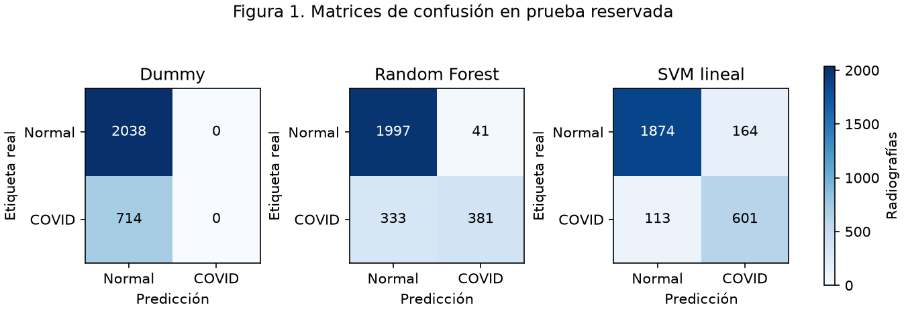
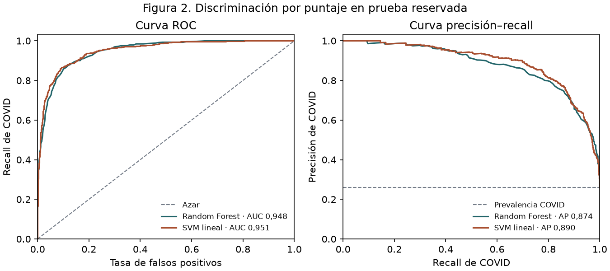
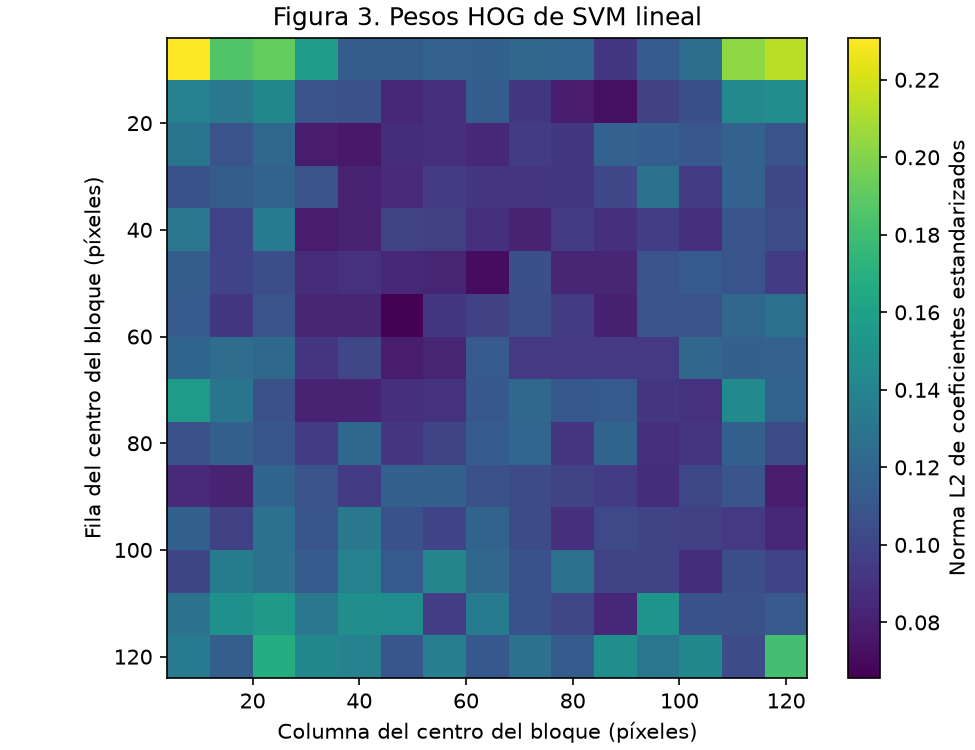

# Ajuste de modelos y evaluación reservada de radiografías

## Datos y diseño

Clasificamos radiografías de tórax en COVID (1) y Normal (0) con la versión 5 de COVID-19 Radiography Database. Después del control de legibilidad y de copias exactas quedaron 13.761 imágenes. La partición estratificada por imagen, con semilla 42, destinó 11.009 a desarrollo (8.153 normales y 2.856 COVID) y 2.752 a prueba reservada (2.038 normales y 714 COVID). Las 200 imágenes usadas en el piloto preliminar se mantuvieron en desarrollo. Dividimos desarrollo en cinco folds comunes a los candidatos. Las imágenes se convirtieron a grises y se redimensionaron a 128 × 128 mediante interpolación bilineal con antialiasing. HOG aportó 8.100 atributos por imagen mediante 9 orientaciones, celdas de 8 × 8, bloques de 2 × 2, normalización L2-Hys y `transform_sqrt=False`.

## Selección en desarrollo

Ajustamos 11 configuraciones mediante `GridSearchCV`, con cinco folds fijos y F1 macro como criterio. Este promedio da el mismo peso a Normal y COVID, pese al desbalance de clases. Para SVM lineal probamos C = 0,1, 1 y 10. El escalador se ajustó dentro de cada fold con sus filas de entrenamiento. Conservamos penalización L2, pérdida `squared_hinge`, liblinear primal, tolerancia `1e-4`, máximo de 10.000 iteraciones y pesos de clase sin ajuste. Para Random Forest cruzamos 100 y 200 árboles, profundidad sin límite y 20, y tamaños mínimos de hoja de 1 y 3. Mantuvimos `max_features="sqrt"`, bootstrap y pesos de clase sin ajuste. Los dos candidatos conservaron la semilla 42.

| Candidato | Mejor F1 macro en desarrollo, media ± desvío muestral |
|---|---:|
| SVM lineal | 0,8760 ± 0,0033 |
| Random Forest | 0,7983 ± 0,0115 |

El mejor SVM usó C=0,1. El mejor bosque usó 200 árboles, profundidad sin límite y hoja mínima de 1. Seleccionamos **SVM lineal** por el mayor F1 macro medio antes de acceder a la prueba. En empate exacto entre candidatos se habría preferido SVM y, dentro de cada grilla, la primera configuración. Dummy, que predice la clase mayoritaria, obtuvo 0,4255 de F1 macro medio en los mismos folds de desarrollo. Los desvíos describen variación entre folds. No se registraron avisos de convergencia en la búsqueda ni en los reajustes. El reajuste de SVM terminó en 788 iteraciones. [Resultados por configuración y fold](../results/tuning_cv.csv)

## Evaluación reservada

Reajustamos Dummy y las dos configuraciones elegidas sobre todo desarrollo. Cada modelo predijo una vez las mismas 2.752 imágenes reservadas. Para Random Forest usamos la probabilidad estimada de COVID y el umbral >0,5. Para SVM usamos el margen de decisión y el umbral >0. Aplicamos `zero_division=0` a las métricas con denominador nulo. Incluimos la curva precisión–recall y la precisión promedio (AP) porque COVID representó el 25,94 % de desarrollo. ROC-AUC y AP se calcularon sobre los puntajes de los candidatos. Dummy emitió una etiqueta constante y no se le asignaron métricas por puntaje.

| Métrica | Dummy | Random Forest | SVM lineal |
|---|---:|---:|---:|
| **F1 macro** | 0,4255 | 0,7926 | 0,8719 |
| Exactitud | 0,7406 | 0,8641 | 0,8993 |
| Precisión COVID | 0,0000 | 0,9028 | 0,7856 |
| Recall COVID | 0,0000 | 0,5336 | 0,8417 |
| Especificidad | 1,0000 | 0,9799 | 0,9195 |
| F1 Normal | 0,8509 | 0,9144 | 0,9312 |
| F1 COVID | 0,0000 | 0,6708 | 0,8127 |
| ROC-AUC | — | 0,9479 | 0,9511 |
| AP | — | 0,8745 | 0,8904 |

**Figura 1.** Las filas son las etiquetas reales y las columnas las predicciones. La escala de color común representa el número de radiografías.

**Figura 2.** Las curvas resumen cómo cambia la discriminación al recorrer los puntajes. La diagonal ROC corresponde al azar y la línea horizontal de precisión–recall a la proporción de COVID en la partición reservada. Los umbrales de clasificación permanecieron fijos.

## Errores e interpretación

| Modelo | Falsos positivos | Falsos negativos |
|---|---:|---:|
| Dummy | 0 | 714 |
| Random Forest | 41 | 333 |
| SVM lineal | 164 | 113 |

Dummy acertó las imágenes normales y clasificó como Normal las 714 imágenes COVID. SVM lineal obtuvo recall de COVID de 0,8417 y especificidad de 0,9195. Para Random Forest, estas métricas fueron 0,5336 y 0,9799, respectivamente. En el modelo seleccionado, la mediana del puntaje fue -0,8009 entre los falsos negativos y 0,6430 entre los falsos positivos. El margen de SVM es proporcional a la distancia con signo respecto de la frontera en la escala del modelo. No es una probabilidad.

**Figura 3.** Agrupamos los coeficientes de SVM sobre atributos HOG estandarizados por bloque de 16 × 16 píxeles. Cada valor de la figura es la norma L2 de los 36 coeficientes del bloque. Los valores altos identifican bloques con mayor peso conjunto en el margen lineal. Al agrupar magnitudes se pierde el signo de los coeficientes y la contribución de cada orientación. Los bloques se solapan, sus atributos pueden estar correlacionados y los pesos pueden reflejar rasgos de adquisición o edición. El mayor valor se ubicó en el bloque centrado en la fila 8 y la columna 8. También se observan pesos altos cerca de otros bordes. Esto motiva considerar márgenes o marcas como posibles atajos visuales. La figura caracteriza el clasificador y no localiza lesiones ni permite determinar la causa de un error individual.

SVM acertó y Random Forest erró en 259 imágenes. Ocurrió lo inverso en 162. Omitimos McNemar porque, aunque las predicciones están emparejadas por imagen, faltan identificadores fiables de pacientes para comprobar que los pares sean independientes entre sí. Los conteos y las diferencias se interpretan de forma descriptiva.

## Costo computacional

| Modelo | Búsqueda en desarrollo (s) | Reajuste en desarrollo (s) | Inferencia de 2.752 imágenes (s) |
|---|---:|---:|---:|
| Dummy | — | 0,0004 | 0,0002 |
| Random Forest | 1202,68 | 46,7617 | 0,1057 |
| SVM lineal | 3831,37 | 607,8891 | 0,1200 |

Los tiempos se midieron en Windows con un Intel Core i5-1135G7, Python 3.12.14 y scikit-learn 1.9.1. La búsqueda incluye los cinco folds por configuración. El reajuste de SVM incluye estimar y aplicar el escalado a desarrollo. Su inferencia incluye el escalado y el cálculo del margen. Los tiempos de inferencia excluyen lectura y HOG. La extracción reservada tardó 22,63 s e incluyó lectura del ZIP, verificación de hashes, decodificación, preprocesamiento y HOG. El modelo seleccionado serializado ocupó 241,8 KiB. Los tiempos son orientativos y dependen del equipo y de su carga. Parte de las búsquedas de los dos candidatos se ejecutó en paralelo.

## Referencia histórica y alcance

La CNN del TFC obtuvo 79,47 % de exactitud en la prueba 10 de D4 (figura 38 y tabla 13, p. 53). D4 retenía 2.462 imágenes por clase tras depuración manual y declaró un esquema 80/10/10. Su prueba 10 evaluó 492 imágenes. Nuestra partición procede de la versión 5 de la base, conserva el desbalance después de la auditoría estructural y reserva aproximadamente el 20 % de las imágenes. No se pudo recuperar el manifiesto de D4 ni sus predicciones por imagen. Las diferencias de filtrado, composición y partición impiden atribuir las diferencias de exactitud al método. Tampoco comparamos directamente los tiempos, pues el TFC utilizó otro equipo y procedimiento. Las cifras describen esta evaluación de radiografías COVID frente a normales y no acreditan desempeño clínico.

## Referencias

- Vega Lencina, N. I. y Armoa, G. S. (2023). *Modelo basado en redes neuronales convolucionales para el diagnóstico de COVID-19 mediante imágenes de rayos X guiado por CRISP-ML(Q)*. Trabajo Final de Carrera, Universidad Gastón Dachary, pp. 36, 43 y 53.
- Rahman, T. y colaboradores. *COVID-19 Radiography Database*, versión 5. [Ficha de Kaggle](https://www.kaggle.com/datasets/tawsifurrahman/covid19-radiography-database/data)
