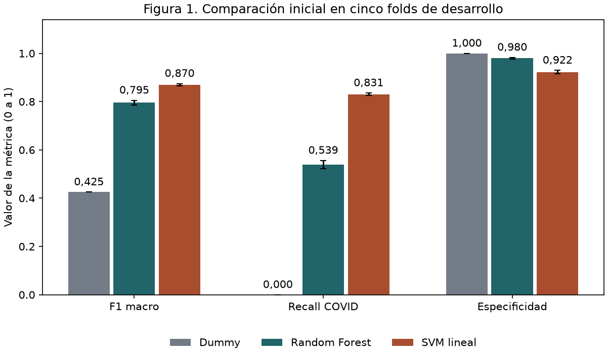

# Comparación inicial de modelos en desarrollo

## Diseño experimental

Los tres modelos usaron las mismas 11.009 imágenes de desarrollo y los cinco folds ya fijados. Se verificaron los hashes de los artefactos del Sprint 02. Los candidatos recibieron la misma matriz HOG de 8.100 atributos y se ajustó una instancia nueva de cada uno por fold. Se conservaron las predicciones de Dummy del Sprint 02. El test quedó reservado.

- **B0 Dummy** usa `most_frequent`. Sus predicciones guardadas fueron todas Normal.
- **C2 Random Forest**, propuesta principal, usa 100 árboles, profundidad sin límite, hoja mínima 1, `max_features="sqrt"`, bootstrap, pesos de clase sin ajuste y semilla 42. Se ejecutó con `n_jobs=-1`.
- **C1 SVM lineal** usa un pipeline con `StandardScaler` y `LinearSVC` con C=1, penalización L2, pérdida `squared_hinge`, pesos de clase sin ajuste y semilla 42. Se fijó el solver primal de liblinear (`dual=False`), tolerancia `1e-4` y máximo de 10.000 iteraciones. En cada fold, el número de filas y las medias aprendidas por el escalador coincidieron con las de entrenamiento. El solver terminó en 20, 19, 19, 24, 19 iteraciones, en orden de fold, sin avisos de convergencia.

## Resultados

COVID=1 es la clase positiva. Se aplicó `zero_division=0`. La tabla informa media y desvío estándar muestral de los cinco folds. F1 macro da el mismo peso a Normal y COVID. El desvío describe variación entre folds y no constituye un intervalo de confianza.

| Métrica | Dummy | Random Forest | SVM lineal |
|---|---:|---:|---:|
| **F1 macro** | 0,425478 ± 0,000065 | 0,795500 ± 0,009817 | 0,870162 ± 0,004566 |
| Exactitud | 0,740576 ± 0,000197 | 0,865747 ± 0,005804 | 0,898537 ± 0,004349 |
| Precisión COVID | 0,000000 ± 0,000000 | 0,904785 ± 0,015016 | 0,789623 ± 0,014355 |
| Recall COVID | 0,000000 ± 0,000000 | 0,539217 ± 0,017033 | 0,830533 ± 0,005427 |
| F1 COVID | 0,000000 ± 0,000000 | 0,675645 ± 0,016153 | 0,809470 ± 0,005878 |
| Especificidad | 1,000000 ± 0,000000 | 0,980131 ± 0,003080 | 0,922359 ± 0,007284 |

**Figura 1.** Las barras muestran la media de cinco folds y las líneas de error su desvío estándar muestral.

SVM lineal obtuvo el mayor F1 macro medio en esta comparación inicial. Su recall de COVID fue 0,8305 y su especificidad 0,9224, frente a 0,5392 y 0,9801 de Random Forest. Dummy alcanzó especificidad de 1 al predecir todas las imágenes como Normal y tuvo recall de COVID de 0. Ambos candidatos superaron a Dummy en F1 macro. La selección definitiva queda para el Sprint 04.

| Modelo | COVID clasificados como Normal | Normales clasificadas como COVID |
|---|---:|---:|
| Dummy | 2.856 | 0 |
| Random Forest | 1.316 | 162 |
| SVM lineal | 484 | 633 |

Los conteos agregan una predicción fuera de fold por imagen. Como faltan identificadores fiables de pacientes, la independencia entre radiografías del mismo paciente sigue sin comprobarse. [Métricas de los 15 resultados por fold](../results/modelos_cv.csv)

## Tiempos

| Modelo | Ajuste por fold (s) | Predicción de la validación completa (s) |
|---|---:|---:|
| Dummy | 0,0006 ± 0,0001 | 0,0001 ± 0,0000 |
| Random Forest | 18,4865 ± 4,1636 | 0,0659 ± 0,0162 |
| SVM lineal | 24,7415 ± 1,6082 | 0,1010 ± 0,0127 |

Se usaron Windows, un Intel Core i5-1135G7 y Python 3.12.14. Los tiempos se expresan como media ± desvío muestral. Incluyen las transformaciones del pipeline SVM y excluyen HOG, carga de filas y cálculo de métricas. Para medir Dummy se repitió su ajuste con las mismas etiquetas y se comprobó que las predicciones coincidieran con las guardadas. Las métricas de Dummy se calcularon sobre las predicciones originales. Los tiempos son orientativos. Durante parte de los ajustes de Random Forest se ejecutaron las pruebas de software en paralelo.

## Verificación

Las 33.027 predicciones corresponden a 11.009 IDs de desarrollo con una predicción por modelo en su fold de validación. Se verificaron la alineación con el manifiesto y Dummy, la ausencia de IDs de test y el recálculo de métricas desde las predicciones guardadas. [Comandos internos de reproducción](../docs/ejecucion/SPRINT_03_MODELOS_CV.md#reproducción-interna)
