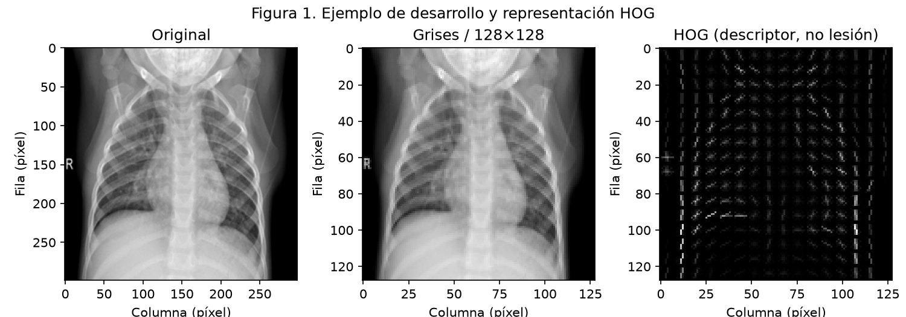
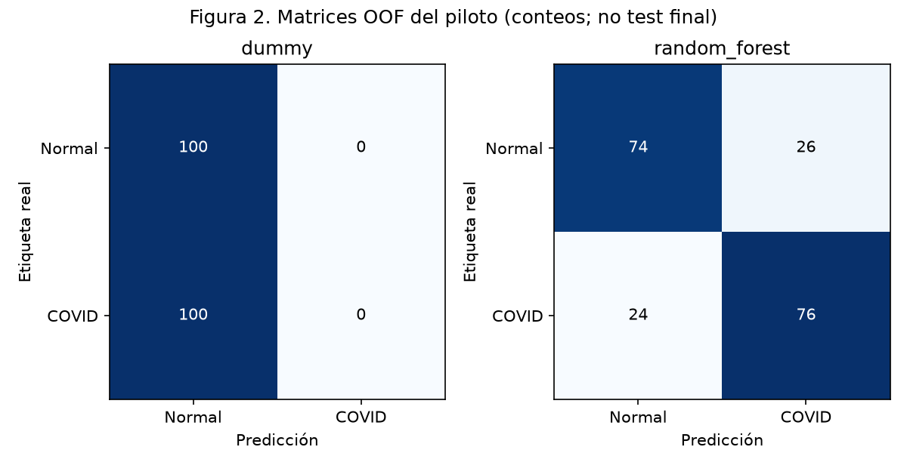
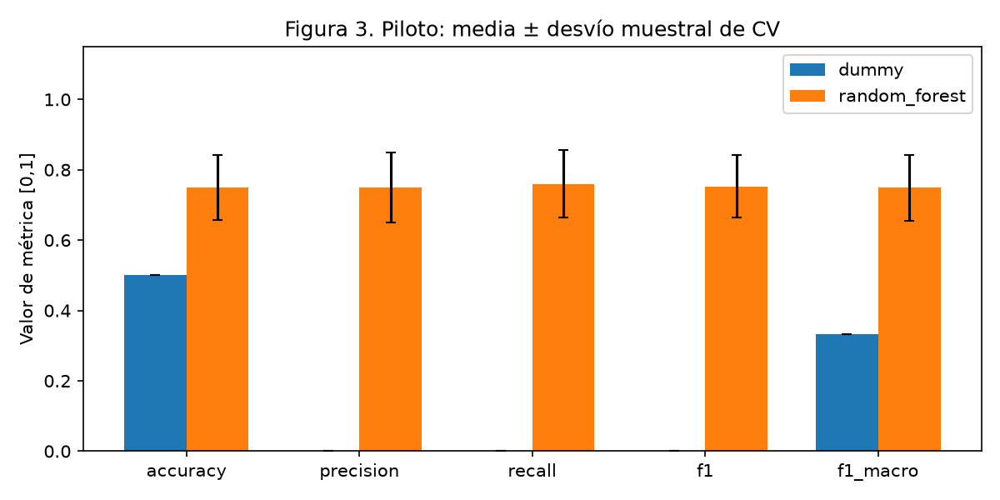

# Evidencia del piloto real · 02/11/2026

**Solo desarrollo exploratorio: 100 COVID y 100 normales.** No son resultados de test final. El modelo principal es RF; Dummy es la baseline. SVM y tuning no se ejecutaron.

## Procedencia y preparación

Fuente: [COVID-19 Radiography Database](https://www.kaggle.com/datasets/tawsifurrahman/covid19-radiography-database), versión 5 (actualización de origen 19/03/2022), descargada el 02/11/2026. Uso indicado por autores: académico/no comercial; etiqueta de licencia: «Data files © Original Authors». Se conserva localmente el ZIP de 816029038 bytes; no se redistribuye la base en Git.

SHA-256 ZIP: `15f44e7111a74f048a54a41bf699637ffaad51b08a9d4a622ff5596879cb7f2b`. Se auditaron únicamente las clases COVID/Normal mediante hashes, sin cargar máscaras ni otras clases. De 3616 COVID y 10192 normales se excluyeron 47 copias exactas (46 COVID, una normal). No hubo conflictos de etiqueta entre duplicados exactos. Se retuvo la primera ruta ordenada y se muestreó con seed 42. Hay una imagen COVID más que las 3615 reportadas históricamente en el TFC; no se modifica ese registro histórico ni se atribuye la diferencia a una causa no verificada.

Los XLSX de metadatos tienen columnas FILE NAME, FORMAT, SIZE y URL, sin patient_id explícito. No se usó URL de procedencia como sustituto de paciente. La CV estratificada por imagen mantiene riesgo residual de dependencia; no se declara independencia garantizada. Los hashes seleccionados deben quedar en desarrollo y excluirse del futuro test. El resto de la base sigue sin asignar; no existía test definitivo.

## Archivos

| Archivo | Contenido |
|---|---|
| [source_manifest.csv](source_manifest.csv) | 200 rutas de origen dentro del ZIP, etiquetas y hashes seleccionados |
| [manifest.csv](manifest.csv) | Rutas locales relativas y pertenencia a desarrollo del piloto |
| [preparation.json](preparation.json) | Conteos, SHA del ZIP y lista de duplicados excluidos |
| [provenance.json](provenance.json) | Fuente, versión, metadatos disponibles, ejemplo y SHA/tamaño del modelo local |
| [predictions_oof.csv](predictions_oof.csv) | Etiqueta, fold y predicciones de ambos modelos para cada imagen |
| [metrics_cv.csv](metrics_cv.csv) | Métricas reales por fold; COVID es positivo |
| [summary.json](summary.json) | Media/desvío muestral, matrices OOF, parámetros y versiones ejecutadas |

Las matrices agregan las predicciones OOF. La media de métricas por fold puede diferir de la métrica calculada sobre todos los pares juntos; no se mezclan esos resúmenes. Dummy desempata la frecuencia a favor de Normal y no predice COVID; se usa zero_division=0. Ninguna métrica procede de evaluar el RF reajustado sobre su entrenamiento. El modelo reajustado sirve para demostrar predicción y queda en `output/piloto_2026-11-02/random_forest.joblib`, excluido de Git.

## Figuras

**Figura 1:** imagen `NORMAL/Normal-1224.png` de la base citada, perteneciente a desarrollo. El resize reduce resolución; HOG representa gradientes y no es un mapa de lesiones. Ejes en píxeles.

**Figura 2:** filas reales y columnas predichas, orden Normal/COVID. RF registra 74 VN, 26 FP, 24 FN y 76 VP; Dummy predice Normal para las 200 imágenes.

**Figura 3:** barras de media y desvío muestral entre cinco folds; las barras de error no son intervalos de confianza. RF tiene accuracy media 0,75 y Dummy 0,50. Las métricas binarias corresponden a COVID; macro pondera por igual las clases.

## Reproducción y atribución

Los comandos están en el [README principal](../../README.md). Para inspeccionar métricas no hace falta reentrenar: se conservan predicciones y folds. Los archivos de prueba sintéticos se generan en temporales y no forman parte de esta evidencia.

Los autores de la base solicitan citar [Chowdhury et al., IEEE Access, 2020](https://ieeexplore.ieee.org/document/9144185) y [Rahman et al., Computers in Biology and Medicine, 2021](https://doi.org/10.1016/j.compbiomed.2021.104319). No se reproduce el subconjunto D4 ni se concluye superioridad frente a su CNN. Véase el [informe breve](../../docs/AVANCE_2026-11-02.md).
