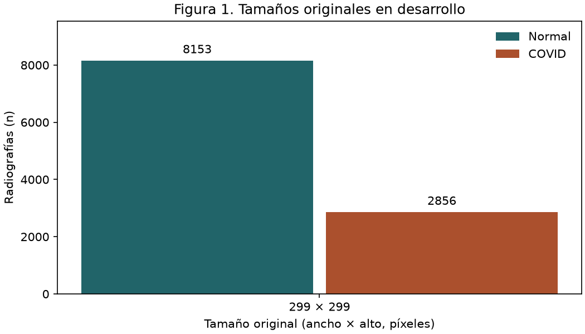
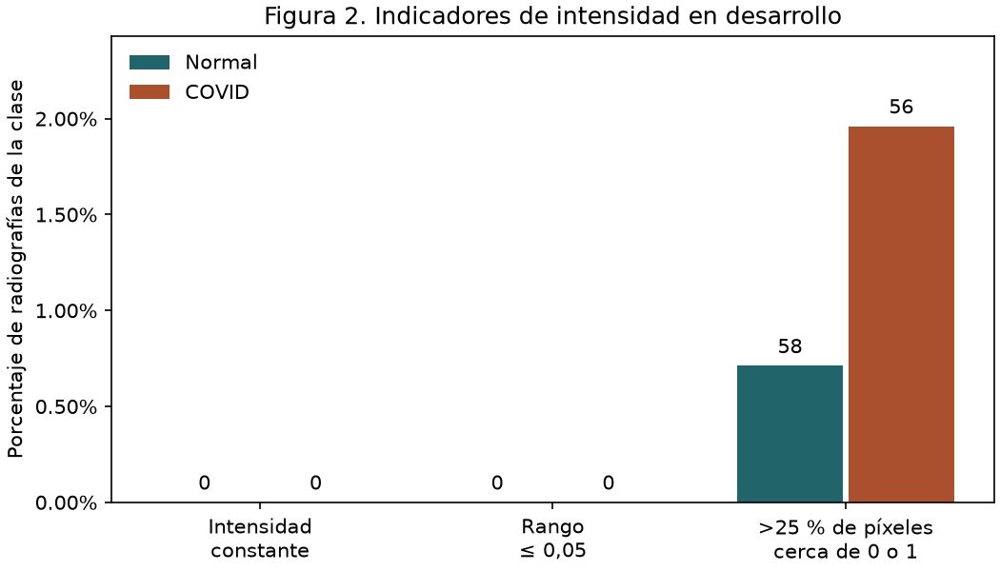

# Auditoría y análisis exploratorio de radiografías

## Fuente y relación con el TFC

Se utilizó la versión 5 de **COVID-19 Radiography Database**, publicada en Kaggle por Tawsifur Rahman y colaboradores y actualizada en origen el 19/03/2022. El equipo comunicó la aprobación de cátedra para usar el conjunto completo. Para esta tarea se incluyeron todas las radiografías elegibles de las carpetas COVID (1) y Normal (0). Las máscaras, la opacidad pulmonar y la neumonía viral quedan fuera de la definición de clases. La ficha indica uso académico y no comercial. [Ficha de la base en Kaggle](https://www.kaggle.com/datasets/tawsifurrahman/covid19-radiography-database/data)

Las etiquetas operativas coinciden con las de D4. El TFC retuvo 2.462 imágenes por clase después de una depuración visual y declaró una división 80/10/10. En las copias disponibles faltan el manifiesto de imágenes de D4 y sus asignaciones originales. El TFC informa 3.615 imágenes COVID en la base de origen y el ZIP auditado contiene 3.616. En esta versión se mantiene la distribución por clase de las imágenes únicas y legibles, con una partición nueva y sin excluir casos por observaciones visuales. El desempeño de la CNN de D4 se considera una referencia histórica. [Trazabilidad del TFC, tabla 2, p. 36, y tabla 3, p. 43](../../docs/FUENTES_Y_TRAZABILIDAD.md)

## Auditoría estructural

| Resultado | Normal | COVID | Total |
|---|---:|---:|---:|
| Imágenes elegibles inventariadas | 10.192 | 3.616 | 13.808 |
| Copias exactas excluidas | 1 | 46 | 47 |
| Imágenes ilegibles | 0 | 0 | 0 |
| Imágenes con etiqueta en conflicto | 0 | 0 | 0 |
| Imágenes retenidas | 10.191 | 3.570 | 13.761 |

El inventario se obtuvo decodificando cada PNG elegible y calculando su SHA-256 sobre los bytes originales. Para un hash repetido con la misma etiqueta se conserva la primera ruta en orden lexicográfico. La regla ante un hash con etiquetas contradictorias es excluir todas sus ocurrencias. Se vinculó cada imagen con el dominio de referencia de su planilla de origen. Ese dominio puede identificar una plataforma que agrega varias fuentes.

**0 de 13.808 imágenes** tienen un grupo de paciente verificable. La separación por ID de imagen y hash controla copias exactas. Sigue siendo posible que radiografías distintas del mismo paciente, o variantes de una radiografía con bytes diferentes, se distribuyan entre particiones.

## Partición y folds

| Partición | Normal | COVID | Total |
|---|---:|---:|---:|
| Desarrollo | 8.153 | 2.856 | 11.009 |
| Test reservado | 2.038 | 714 | 2.752 |

Se reservaron aproximadamente 20 % de cada clase con semilla 42. Los 200 hashes de 00-A están presentes y quedaron en desarrollo. Sobre desarrollo se fijaron cinco folds estratificados comunes. Cada fila tiene un único fold de validación y sirve para entrenamiento en los cuatro restantes. Ambas clases están presentes en test y en entrenamiento y validación de cada fold. Se verificó la disyunción de IDs y hashes entre desarrollo y test y entre entrenamiento y validación en cada fold. En cada ejecución, la exploración posterior a la asignación leyó únicamente imágenes de desarrollo.

## Exploración de desarrollo

Las 11.009 radiografías miden originalmente 299 × 299 píxeles. En desarrollo, Normal representa 8.153 de 11.009 (74,1 %) y COVID 2.856 (25,9 %). Se conservó el contrato de grises con valores `float32` en [0, 1], conversión según el rango del tipo original y resize bilineal directo a 128 × 128 con antialiasing, sin recorte ni normalización mín–máx por imagen.

**Figura 1.** Conteo por tamaño y clase en desarrollo. Las dos clases tienen la misma resolución original en esta partición.

Se exploraron indicadores de intensidad sobre las imágenes de desarrollo convertidas a grises y redimensionadas. No se observaron imágenes de intensidad constante ni con rango máximo–mínimo ≤ 0,05. En cambio, 58 normales (0,71 %) y 56 COVID (1,96 %) tienen más de una cuarta parte de los píxeles cerca de uno de los extremos de intensidad, con valores ≤ 0,01 o ≥ 0,99. En una revisión visual de los primeros cuatro casos por clase que superaron el umbral, en orden del manifiesto, se observaron márgenes negros amplios y, en algunos casos, marcas superpuestas. La muestra ilustra el indicador sin estimar la frecuencia de esos problemas. Los umbrales se usaron para describir desarrollo y no para excluir imágenes.

**Figura 2.** Porcentaje dentro de cada clase para cada indicador. Los números sobre las barras son conteos de imágenes. Los denominadores son 8.153 Normal y 2.856 COVID.

La referencia de origen es Kaggle para Normal, mientras que COVID reúne varios dominios de referencia. Esa diferencia permite plantear la hipótesis de que rasgos de adquisición o edición asociados al origen actúen como atajos. La auditoría no identifica pacientes ni establece qué rasgos utilizaría un clasificador.

## Referencias

- Chowdhury et al., *Can AI Help in Screening Viral and COVID-19 Pneumonia?*, IEEE Access, 2020. [Artículo](https://doi.org/10.1109/ACCESS.2020.3010287)
- Rahman et al., *Exploring the Effect of Image Enhancement Techniques on COVID-19 Detection Using Chest X-ray Images*, Computers in Biology and Medicine, 2021. [Artículo](https://doi.org/10.1016/j.compbiomed.2021.104319)
